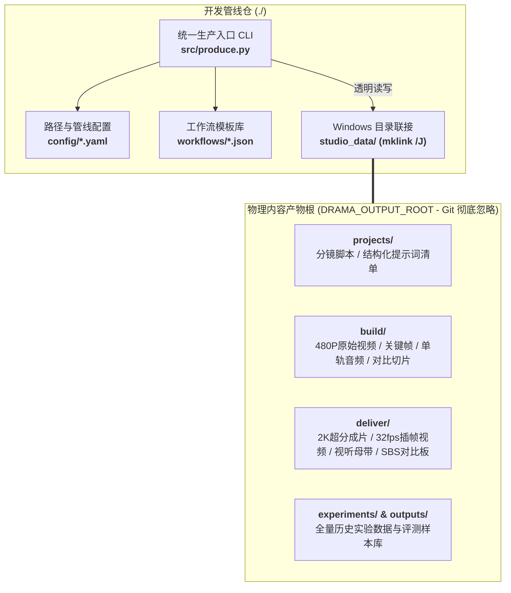

# Local-Drama-Studio · Script-to-Film

面向全媒体（自媒体短视频、AI 电影短片、硬核技术科普）的**工业级本地全模态内容生产系统**：通过双引擎生图、14B 旗舰级视频生成、商业合规音频生成与多轨自动化混音，实现 100% 可商用变现的端到端自动化生产闭环。

> **唯一需求入口：[docs/PRD.md](docs/PRD.md)（SSOT）**  
> **文档索引：[docs/README.md](docs/README.md)** ｜ **横屏防糊指南：[docs/WIDESCREEN_VIDEO_GENERATION_GUIDELINES.md](docs/WIDESCREEN_VIDEO_GENERATION_GUIDELINES.md)** ｜ **决策记录：[docs/DECISIONS.md](docs/DECISIONS.md)**

---

## 一、 最新工业级技术栈

| 模块 | 职责与定位 | 生产引擎 / 核心技术 | 硬件调度策略 |
| :--- | :--- | :--- | :--- |
| **生图主引擎** | 写实人像、电影光影、情绪质感、东方美学 | **Z-Image Turbo**（阿里 6B 单流 DiT 蒸馏底模，8 步，CFG 1.0，**裸跑零 LoRA**） | Qwen3-4B 文本编码器常驻 CPU，Diffusion 跑在 Arc A750 |
| **生图副引擎** | 工业机械透视、气动流线图、多语种排版 | **FLUX.3 Klein**（16 步蒸馏底模，自动开启语义扩写防短词衰减） | Qwen3-VL-4B 编码器常驻 CPU，自动触发 SBS 对比图板 |
| **旗舰视频** | 电影级连续动态、物理光影与景深虚化 | **Wan 2.2-14B I2V**（双专家 GGUF Q4_K_M + LightX2V 6 步蒸馏 LoRA） | 64GB DDR5 内存分块交换（Block Swap），显存稳定 6.5GB |
| **视频后处理** | 2K 无畸变超分 + 32fps 丝滑插帧 | **FFmpeg 2x Lanczos + minterpolate 双向光流运动预测** | 纯 CPU 算子，100% 杜绝 NVIDIA CUDA 专有插件 |
| **商业音频** | 电影级氛围配乐、环境拟音（雨声/街噪）、古典钢琴 | **Stable Audio Open 1.0**（Stability Community License，年入<$1M 免费商用） | 纯 CPU（AVX2/OpenMP），25 步，与视频渲染零冲突 |
| **管弦配乐** | 宏大影视管弦乐、多声部纯音乐 | **ACE-Step 1.5 XL Turbo**（StepFun 5B DiT，**MIT / Apache 2.0 永久商用**） | 纯 CPU，8 步快速推理 |
| **中文旁白** | 逐句台词与故事讲述 | **VoxCPM2**（零样本克隆，48kHz，服务端口 50000） | 纯 CPU 调度 |
| **自动化混流** | 视听硬对齐、双轨音量动态加权均衡 | **FFmpeg 8.1 自动化多轨混音器**（BGM -16dB + SFX -10dB） | 脚本化秒级导出母带 |

---

## 二、 架构物理隔离设计

为确保 Git 代码仓轻量纯净与生产大文件的彻底解耦，系统建立了双根物理隔离架构：



---

## 三、 统一生产入口 CLI (`src/produce.py`)

系统提供了一站式生产入口，内置自动化场景路由与画幅保护策略：

```powershell
# 1. 检查物理路径、目录联接、ComfyUI 服务与模型状态
python src/produce.py status

# 2. 直出 Z-Image 电影写实人像（写实人像、情绪短片自动走 Z-Image Turbo 裸跑）
python src/produce.py image --project demo01 --type portrait --prompt "A candid 35mm film portrait of a 25yo East Asian woman in rainy Tokyo, authentic skin pores, cinematic bokeh"

# 3. 双引擎比拼模式（工业风洞、机械结构、课件排版自动触发双跑，生成 2030x877 SBS 择优图板）
python src/produce.py image --project car01 --type industrial --prompt "Engineering cutaway diagram of a high-performance twin-turbo V8 engine, technical illustration, labeled components"

# 4. Wan 14B 视频端到端生产（内置 16:9 景别防糊保护 + 2K 超分 + 32fps 光流补帧 + 商业音频混流）
python src/produce.py video --project demo01 --image "studio_data/deliver/demo01/anchor.png" --aspect 16:9
```

---

## 四、 核心生产策略与避坑指南

### 1. 16:9 横屏防糊守卫（Widescreen Guard）
* **底层成因**：Wan 14B 在 480P 规格下，16:9 垂直高度仅有 480 像素（Latent 垂直高度仅 30 Token）。若拍摄大远景/全身漫步，整张人脸在潜空间仅占 **2~3 个 Token**，解码必然糊成面具；
* **内置守卫**：当指定 `--aspect 16:9` 时，CLI 自动校验并注入好莱坞式**中近景胸像（Medium Close-up）与浅景深大光圈虚化**提示词，让人脸占画面垂直比例达 30% 以上（Latent Token 达 12+），确保横屏获得与竖屏一致的发丝与毛孔质感。完整规范见 [docs/WIDESCREEN_VIDEO_GENERATION_GUIDELINES.md](docs/WIDESCREEN_VIDEO_GENERATION_GUIDELINES.md)。

### 2. 商业版权穿透与法律合规
* **严禁商用陷阱**：Meta MusicGen 与 HKUST YuE 2.0 均携带 `CC-BY-NC 4.0` 许可证，严禁用于带激励视频、付费课程与商单交付；
* **合规基石**：全管线仅挂载 **`Stable Audio Open 1.0`**（年收入 <$1M 免费商用）与 **`ACE-Step 1.5 XL`**（MIT / Apache 2.0），全流程 100% 具备商业变现资质。

---

## 五、 仓库目录规范

| 路径 | 属性 | 职责说明 |
| :--- | :---: | :--- |
| `src/produce.py` | 核心 | 统一生产调度 CLI（支持 `status`, `image`, `video`） |
| `src/drama_studio/` | 核心 | Python 制作层领域模型（contracts / style / voice / motion / paths） |
| `config/local-paths.yaml` | 本地 | 本地物理路径配置文件（由 Git 严格忽略，配置本地 output_root 与 model 路径） |
| `config/pipelines.yaml` | 规范 | 场景路由、双引擎比拼策略、Wan 14B 视频与商业音频配置 |
| `config/models.yaml` | 规范 | Canonical 外部模型清单与加载器映射 |
| `workflows/` | 模版 | ComfyUI API 格式工作流（`z_image_turbo_api.json`, `flux3_klein_api.json`, `wan22_14b_i2v_api.json`） |
| `studio_data/` | 联接 | Windows 目录联接（映射本地产物根 DRAMA_OUTPUT_ROOT，Git 忽略） |
| `docs/` | 规范 | 架构决策 (ADR)、全维评测报告、横屏规范与拍摄指南 |
