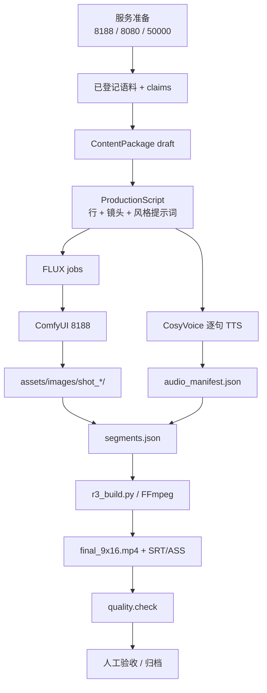
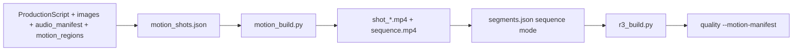
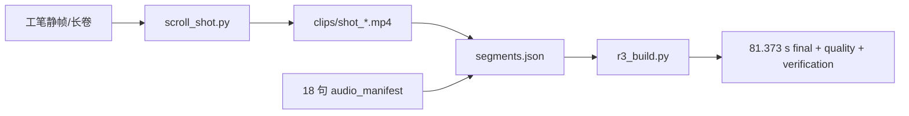
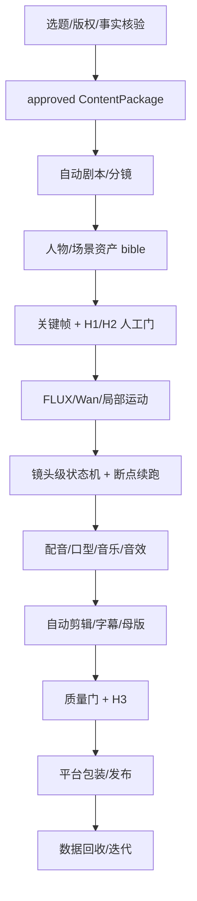
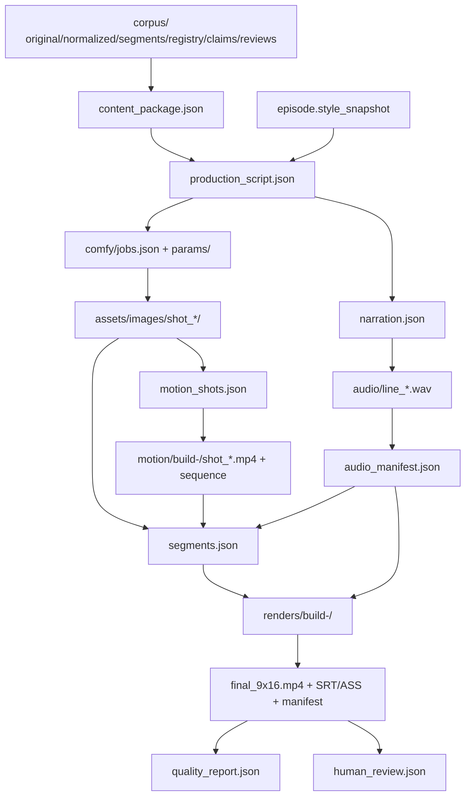

# 生产管线指南

> 文档状态：Phase B 生产流程文档（2026-11-04）
> 适用：v1.0 基线 + 当前工作区
> 原则：以实际代码为准；规划路径单独标注，不混入“已验证”。
> 相关：[PROJECT_OVERVIEW.md](PROJECT_OVERVIEW.md)、[USER_GUIDE.md](USER_GUIDE.md)、[PRODUCTION_CONFIG_GUIDE.md](PRODUCTION_CONFIG_GUIDE.md)、[QUALITY_AND_METRICS.md](QUALITY_AND_METRICS.md)

---

## 0. 先看结论：当前有四条生产路径

| 路径 | 适用 | 实现 | 真实案例 | 状态 |
|---|---|---|---|---|
| **P1 自动链** | 短文本夹具、验证闭环 | ContentPackage → LLM → TTS → FLUX → segments → `r3_build` | P1 14.0 s | `PASS_VERIFIED` |
| **R3 人工链** | 已有人工编排的静帧/Wan/音频 | `r3_build.py` 直接合成 | R3 38.042 s | `PASS_VERIFIED` |
| **Motion 链** | 需要确定性相机/局部微动/转场 | `motion.plan → motion.render → segments(sequence) → r3_build` | P1 motion 10.0 s；M7 两片 | `PASS_VERIFIED`（技术） |
| **长卷 scroll 链** | 工笔长卷、预渲染 clips | `scroll_shot.py` 生成逐镜头 clips → `segments.json` → `r3_build` | **81.373 s 工笔** | `PASS_VERIFIED`（技术+验证） |

> **不要把这四条路径混为一谈。** 81.373 s 工笔不是 `motion.plan` 自动运动；P1 不是人工编排；M7 是 2 镜头技术样片，不是完整作品一致性证明。

---

## 1. 总流程图

### 1.1 当前已验证路径（A）



### 1.2 运动路径（B）



### 1.3 长卷路径（C，81.373 s 案例）



### 1.4 未来完整短剧（D，未实现）



**D 不是现状。** 未实现：镜头级状态机、断点续跑、人物一致性、口型、自动发布、数据闭环、批处理调度。

---

## 2. 阶段 0：环境与服务准备

| 项 | 内容 |
|---|---|
| **目的** | 让 8188 / 8080 / 50000 可用，模型/字体/FFmpeg 就绪 |
| **输入** | Windows 11、Python 3.12、uv、FFmpeg 8.1、模型权重、字体 manifest |
| **输出** | 服务健康；`doctor` 报告 |
| **Schema** | `logs/doctor-*.json` |
| **实际模块** | `scripts\setup.ps1`、`scripts\doctor.ps1`、`drama doctor`、`scripts\start.ps1`、`scripts\llm_server.ps1`、`scripts\cosyvoice_server.ps1` |
| **实际命令** | `uv sync --python 3.12`；`scripts\setup.ps1 -WithComfyUI`；`scripts\doctor.ps1`；`scripts\start.ps1`；`scripts\llm_server.ps1 -Action start`；`scripts\cosyvoice_server.ps1 -Action start -Model sft` |
| **外部服务** | ComfyUI 8188；llama.cpp 8080；CosyVoice 50000 |
| **配置** | `config/settings.yaml`、`config/models.yaml`、`config/audio.yaml` |
| **资源** | XPU 8 GB；LLM CPU ~19 GB RAM；CosyVoice CPU |
| **成功验收** | `doctor` 必需项无 FAIL；三个服务 `/health` 正常；`/system_stats` 有 XPU |
| **常见失败** | 8188 未监听；torch XPU 不可用；模型大小不符；8080 被外部实例占用；50000 被另一个运行时占用 |
| **失败恢复** | 先 `doctor`；不要同时启动两个 8080/50000 实例；`stop.ps1` 只杀项目 ComfyUI 树；`llm_server.ps1` 只停自己的实例 |
| **断点续跑** | 服务可独立重启；不涉及生产状态 |
| **当前状态** | `PASS_VERIFIED`（本次审计时服务未启动，doctor 15 PASS / 0 FAIL） |

---

## 3. 阶段 1：内容源 → ContentPackage

| 项 | 内容 |
|---|---|
| **目的** | 把已登记语料 + 可校验 claim 变成严格的 `ContentPackage(draft)` |
| **输入** | 语料目录：`original_text.txt`、`normalized_text.txt`、`segments.json`、`source_registry.json`、`claims.json`、`reviews.json` |
| **输出** | `content_package.json` |
| **Schema** | `ContentPackage`：`schema_version/work/positioning/analysis/video/provenance`；`verification_status=draft` |
| **实际模块** | `drama_studio.content_package.build_content_package`；`literary_intelligence.harness.evidence_validator` |
| **实际命令** | `.venv\Scripts\python.exe -m drama_studio.content_package --corpus <corpus> --out <content_package.json>` |
| **外部服务** | 无（纯本地） |
| **配置** | 语料文件；无全局配置 |
| **资源** | 秒级 CPU |
| **成功验收** | Pydantic 校验通过；每个 claim 过证据校验；无效/未审核 claim 写入 warnings；场景/字幕数量在 schema 上限内 |
| **常见失败** | 缺 `source_registry.json`/`claims.json`；locator 不存在；quote 不在原文；schema 上限 |
| **失败恢复** | 修语料/claim；不要放宽 schema；保留原文件 |
| **断点续跑** | 无状态，可重复运行；每次覆盖同一 `content_package.json`（注意旧文件） |
| **当前状态** | `PASS_VERIFIED`（P1 4 场景）/ `PASS_LIMITED`（长篇未跑） |

### 3.1 `ContentPackage` 与风格的关系

`ContentPackage` **没有 `style_id` 字段**。它是内容/证据层，不绑定视觉风格；风格在 `ProductionScript` 阶段由期数 `style_snapshot` 引入。若产品要求“作品级风格从内容包开始继承”，需要 Phase C 扩展（当前未实现）。

---

## 4. 阶段 2：文案与分镜（ProductionScript）

| 项 | 内容 |
|---|---|
| **目的** | 本地 LLM 把 ContentPackage + 风格快照转成严格 `ProductionScript` |
| **输入** | `content_package.json`；`style_snapshot.json`（期数快照） |
| **输出** | `production_script.json`；`narration.json`；`script_raw_attempt*.json` |
| **Schema** | `ProductionScript`：`title/logline/lines/shots/style_id/style_sha256/package_sha256/model/generated_at`；每行被至少一个镜头覆盖；镜头索引连续 |
| **实际模块** | `drama_studio.script_engine.generate_script`；`literary_intelligence.harness.llm_client.chat_json` |
| **实际命令** | `.venv\Scripts\python.exe -m drama_studio.script_engine --package ... --style ... --out ... --base-url http://127.0.0.1:8080/v1 --model Qwen3-30B-A3B-Instruct-2507 --api-key sk-local --timeout 900 --max-tokens 2000` |
| **外部服务** | llama.cpp 8080（Qwen3-30B-A3B-Instruct-2507） |
| **配置** | `config/settings.yaml` `llm.*`；期数 `style_snapshot` |
| **资源** | 数分钟 CPU；~19 GB RAM |
| **成功验收** | 3–5 镜头；所有台词行被覆盖；Schema 通过；raw 输出保留；`style_sha256/package_sha256` 记录 |
| **常见失败** | LLM 未启动；JSON 不合法；镜头数不在 3–5；line_indexes 越界；style snapshot 缺失 |
| **失败恢复** | 有界 3 次尝试（初次 + 2 次修复）；失败保留 raw；`--reuse` 只验证已有脚本；不要手改后伪造成 LLM 产物 |
| **断点续跑** | `--reuse` 可跳过 LLM；每次新生成覆盖 `production_script.json` |
| **当前状态** | `PASS_VERIFIED`（CLI 真实 4 镜头；工作台新生成路径待重新实证） |

### 4.1 风格锁定（当前）

- `script_engine` 把 `style_snapshot.json` 的 `visual_language/positive_prompt/negative_prompt` 拼进每个镜头 `visual_prompt`。
- `ProductionScript.style_id` = snapshot 的 `id`；`style_sha256` = 快照规范化哈希。
- 这保证**提示词层**可追溯，但不保证 `motion.plan/aesthetic.plan` 使用同一个 YAML preset（见 §6/§8）。

---

## 5. 阶段 3：镜头美学计划与静态图（FLUX）

### 5.1 美学 A/B（可选但推荐）

| 项 | 内容 |
|---|---|
| **目的** | 在生成前冻结六维设计 + A/B 变体，避免“先出图再解释” |
| **输入** | `production_script.json`；`config/styles.yaml`；可选 `designs.json`/`axes.json` |
| **输出** | `aesthetic_plan.json`；`snapshots/snapshot-<time>/{A,B}/`；`jobs_A.json`/`jobs_B.json`；`provenance.json` |
| **Schema** | `AestheticPlan`/`ShotAestheticSet`/`ShotVariant`；A/B 只差一个轴 |
| **实际模块** | `drama_studio.aesthetics`、`scripts/aesthetic_plan.py`、`production.build_aesthetic_jobs` |
| **实际命令** | `scripts\aesthetic_plan.py --script ... --style ink_wash --out ... --snapshot-root ...` |
| **外部服务** | 无（计划阶段） |
| **配置** | `config/styles.yaml` `aesthetic_profile` |
| **资源** | 秒级 CPU |
| **成功验收** | 每个镜头一个六维设计 + A/B；除一个轴外字段相同；snapshot 非空目录拒绝；jobs 可被 `r1_batch` 读取 |
| **常见失败** | style_id 不是 YAML preset；designs 结构错；snapshot 已存在；参考资产缺失 |
| **失败恢复** | 新时间戳 snapshot；不覆盖旧版；人工改设计重建 |
| **断点续跑** | 每次新 snapshot；旧 snapshot 保留 |
| **当前状态** | `PARTIAL` + `PENDING_HUMAN_REVIEW`（8 张实图） |

### 5.2 FLUX 生成

| 项 | 内容 |
|---|---|
| **目的** | 生成 576×1024 竖屏静帧（或 A/B 变体） |
| **输入** | `jobs.json` + `params/*.json` + `workflows/r0_flux_t2i_api.json` |
| **输出** | `assets/images/<shot>/shot_*.png`；`job.json`；`workflow.submitted.json`；`history.json` |
| **Schema** | job：`id/workflow/params/out`；params：`positive_prompt/negative_prompt/seed/width/height/steps/cfg/filename_prefix` |
| **实际模块** | `scripts/r1_batch.py`、`scripts/r0_comfy_probe.py` |
| **实际命令** | `scripts\r1_batch.py --jobs <jobs.json> --timeout 1800`；或工作台 `comfy.batch` |
| **外部服务** | ComfyUI 8188 |
| **配置** | 工作流 JSON；`production.build_jobs` 默认 576×1024 / 4 步 / CFG 1.0 / seed_base 7100 |
| **资源** | 竖屏 22–53 s/张；峰值 ~2.8–3.0 GiB |
| **成功验收** | `job.json status=success`；输出存在且 sha256 一致；图片非空非黑 |
| **常见失败** | 8188 未监听；OOM；工作流节点缺失；输出下载失败；参考图未 staging |
| **失败恢复** | 最多 3 次（初次+2）；失败保留 `job.json`/日志；不降分辨率静默重试 |
| **断点续跑** | `job_is_done` 检查 success + 输出哈希；`--force` 重跑；`--only` 指定 job |
| **当前状态** | `PASS_VERIFIED`（历史；当前 8188 未启动） |

### 5.3 静态质量门（已收口，未注册任务）

| 项 | 内容 |
|---|---|
| **目的** | 动画前检查空/黑、留白、边缘密度、高频、饱和、语义缺陷 |
| **输入** | 单张 PNG；`--style`；可选 `--manual`/`--aesthetic` |
| **输出** | `static_quality.json`，`overall_status=PASS_STATIC/PARTIAL/PENDING/FAIL` |
| **实际模块** | `scripts/static_quality.py` |
| **实际命令** | `scripts\static_quality.py --image ... --style ink_wash --out ...` |
| **外部服务** | 无 |
| **成功验收** | 客观指标通过；语义清单全部 PASS 才 `PASS_STATIC`；PENDING/PARTIAL 不算通过 |
| **常见失败** | 客观 blank/black；人工清单缺失 → PENDING；语义 FAIL |
| **失败恢复** | 修图/重摇；不要用自动指标替代人工 |
| **断点续跑** | 每张图独立 |
| **当前状态** | `IMPLEMENTED_NOT_VERIFIED`；`motion.plan` 默认要求每镜头报告，缺失即失败；`--skip-static-gate` / 任务 `skip_static_gate` 才可显式跳过；`static.check` 任务已注册，可在工作台触发 |

---

## 6. 阶段 4：视频/运动

### 6.1 Wan 视频（可选）

| 项 | 内容 |
|---|---|
| **目的** | 生成缓慢推近/局部动态的 Wan 片段 |
| **输入** | `workflows/r0_wan_i2v_api.json` 或 `t2v`；`params`；首帧图 |
| **输出** | MP4/PNG 序列；`job.json` |
| **Schema** | params：`positive_prompt/negative_prompt/input_image/seed/width/height/frames/steps/cfg/shift/filename_prefix` |
| **实际模块** | `scripts/r1_batch.py` |
| **实际命令** | `scripts\r1_batch.py --jobs <wan_jobs.json> --timeout 7200` |
| **外部服务** | ComfyUI 8188 |
| **配置** | Wan 20 步强制；73 帧默认；分辨率必须能被 32 整除 |
| **资源** | 1024×576/73 帧约 40–43 min；576×1024/73 帧约 36.4 min；峰值 ≤6.12 GiB |
| **成功验收** | 输出可解码、首尾帧无颜色漂移；主体运动方向符合设计 |
| **常见失败** | 10 步彩虹伪影；121 帧颜色漂移；主体位移方向错误；OOM |
| **失败恢复** | 退回静帧 + Ken Burns；改分镜；不把 Wan 当作精确主体位移工具 |
| **断点续跑** | 同 `r1_batch` |
| **当前状态** | `PASS_VERIFIED`（推近类）/ `PASS_LIMITED`（精确位移） |

### 6.1.1 从 ProductionScript 生成 Wan I2V jobs

- `ScriptShot.type=video` + `video_prompt` 表示该镜头用 Wan I2V，而不是静帧推拉。
- 先用 FLUX 生成 `<shot_id>/` 关键帧；`scripts/video_jobs.py` 读取脚本和关键帧，写 `work/comfy/jobs_video.json`。
- jobs 的 `reference` 指向关键帧；缺关键帧直接失败，不静默回退。
- 生成后用 `segments.build --clips work/assets/videos --allow-partial-clips` 混合 Wan 片段与静帧；显式 video 镜头缺片段仍报错。
- 工作台任务 `video.jobs` 只生成 jobs，不执行生成；执行仍走 `comfy.batch`。

```powershell
.venv\Scripts\python.exe scripts/video_jobs.py `
  --script work\production_script.json `
  --keyframes work/assets/images `
  --out work\comfy\jobs_video.json `
  --frames 73
```

### 6.2 确定性运动（motion.plan / motion.render）

| 项 | 内容 |
|---|---|
| **目的** | 用 FFmpeg 确定性实现相机缓动、局部微动、转场 |
| **输入** | `production_script.json`、`assets/images/`、`audio_manifest.json`、可选 `motion_regions.json`、`config/styles.yaml` |
| **输出** | `motion_shots.json`；`motion/build-<time>/shot_*.mp4`；`sequence/sequence.mp4`；`motion_manifest.json` |
| **Schema** | `MotionPlan{style_id,fps,shots}`；`ShotSpec{id,source,duration_seconds,motion,camera,local_motion,regions,plates,transition_in,static_quality}` |
| **实际模块** | `drama_studio.production.build_motion_plan`、`scripts/motion_build.py`、`drama_studio.motion.render` |
| **实际命令** | `.venv\Scripts\python.exe -m drama_studio.production --motion-plan --script ... --images ... --audio ... --out ... --style ink_wash --regions ... --align-audio --leading-ms 300`；`scripts\motion_build.py --plan ... --out ...` |
| **外部服务** | 无（纯 CPU/FFmpeg） |
| **配置** | `config/styles.yaml` `motion.camera/local_policy/transition` |
| **资源** | 每镜头约 10–40 s CPU；4 镜头 10 s 约 28.5 s CPU |
| **成功验收** | 序列时长 ≥ 旁白；转场不吞镜头；`motion_manifest` 有逐镜头质量；`check_motion_quality` PASS |
| **常见失败** | 缺图片/音频；style_id 不是 YAML preset；静态门 FAIL；区域/图层校验失败；序列短于旁白 |
| **失败恢复** | 修 plan/素材；新 build 目录；不拉伸冻结画面 |
| **断点续跑** | 每次新 `motion/build-<time>`；旧版保留 |
| **当前状态** | `PASS_VERIFIED`（技术；P1/M7）；人工审美 PENDING |

### 6.3 长卷 clips（scroll_shot.py）

| 项 | 内容 |
|---|---|
| **目的** | 为工笔长卷生成逐镜头横移 clips |
| **输入** | `scroll_shots.json`：`id/source/duration_seconds/pan_start_px/pan_end_px`；`--style court_green_fine_line` |
| **输出** | `<out>/<id>.mp4`（静音；音频后合成） |
| **实际模块** | `scripts/scroll_shot.py`、`scripts/s2_build.py` |
| **实际命令** | `scripts\scroll_shot.py --style court_green_fine_line --shots <scroll_shots.json> --out-dir <clips>` |
| **外部服务** | 无 |
| **成功验收** | 每镜头 clip 存在、可解码、时长/横移符合 shot list |
| **常见失败** | 源图宽度不足；style 未声明 `scroll_pan`；输出已存在（需 `--force`） |
| **失败恢复** | 重跑单镜头；不覆盖历史目录 |
| **断点续跑** | 已有 clip 跳过；`--force` 重渲染 |
| **当前状态** | `PASS_VERIFIED`（81.373 s 工笔案例） |

---

## 7. 阶段 5：配音（TTS）

| 项 | 内容 |
|---|---|
| **目的** | 逐句合成旁白/朗诵，产出 48 kHz WAV + manifest |
| **输入** | `narration.json`（`header`、`lines`、`mode`、`speaker`、`speed`） |
| **输出** | `audio/line_*.wav`；`audio_manifest.json`；`pronunciation_report.json` |
| **Schema** | manifest：`speaker/speed/mode/mode_spec/sample_rate/narration/narration_sha256/endpoint/header/ledger/lines[]`；每行 `file/sha256/duration_seconds/pause_after_ms/text/display_text` |
| **实际模块** | `drama_studio.voice.tts.synthesize_narration`；`scripts/r3_tts.py`；`voice/pronunciation.py`；`voice/recitation.py` |
| **实际命令** | `scripts\r3_tts.py --narration ... --out ... --manifest ... --speaker 中文女 --mode recitation` |
| **外部服务** | CosyVoice 50000（SFT 300M 或 zero-shot 0.5B） |
| **配置** | `config/audio.yaml` `tts.*`、`narration_modes.*`、`pronunciation.yaml` |
| **资源** | CPU；SFT 约 2–4 分钟/条（按文本长度）；zero-shot 更慢 |
| **成功验收** | 每行 WAV 存在、48 kHz mono、时长 >0、哈希一致；模式/音色可追溯；发音报告记录 |
| **常见失败** | 50000 未启动；模型未加载；zero-shot prompt_text 缺失；文本过长；返回空音频 |
| **失败恢复** | 只重跑失败行；manifest 有效时复用；`--force` 重合成；不要手工拼接假音频 |
| **断点续跑** | `_manifest_ok` 校验 narration sha/speaker/speed/mode/逐行哈希；有效则复用 |
| **当前状态** | PRD 目标：默认 0.5B zero-shot；SFT 仅显式可选。默认配置已切换；默认 zero-shot 2 行 + 显式 SFT 1 行真实通过，错配双向拒绝；`PRD-TTS-001 = PASS_VERIFIED` |

### 7.1 模式与模型（产品决策）

- 默认（PRD）：CosyVoice2-0.5B zero-shot；参考音 + 逐字参考文本。
- 显式可选：SFT + 中文女 + CosyVoice-300M-SFT。
- 禁止静默回退：0.5B 不可用/加载失败/参考音缺失 → 失败，不回退 300M。
- 已实现：`--tts-mode` / 任务 `tts_mode` 显式选择；`/health` 校验 300M-SFT vs 0.5B；manifest 记录 `tts_mode/model_class/speaker_id`。
- 当前状态：`config/audio.yaml` 默认 `tts.mode: zero_shot`；默认任务真实加载 0.5B；`PRD-TTS-001 = PASS_VERIFIED`。SFT 仅显式可选。
- 详见 [PROJECT_OVERVIEW.md](PROJECT_OVERVIEW.md) §5、[PRODUCTION_CONFIG_GUIDE.md](PRODUCTION_CONFIG_GUIDE.md) §6。

### 7.2 音频 QA

| 项 | 内容 |
|---|---|
| **目的** | 逐行检查响度、削波、静音、时长；有 timeline 时核对字幕时序 |
| **输入** | `audio_manifest.json`；可选 `timeline.json` |
| **输出** | `audio_qa_report.json` |
| **实际模块** | `drama_studio.quality.check_audio_manifest`；`audio.qa` 任务 |
| **实际命令** | `.venv\Scripts\python.exe -m drama_studio.quality --audio-manifest ... --timeline ...` |
| **成功验收** | 0 failed/clipped/quiet/broken；timeline PASS；发音仍 PENDING → `PARTIAL` |
| **当前状态** | `PASS_VERIFIED`（波形/时序）；发音人工复核 PENDING |

---

### 7.3 多轨音频（P1）

> 代码位置：`src/drama_studio/voice/audio_timeline.py`、`audio_assets.py`、`mix.py`；`r3_build.py --audio-timeline`。
> 这是**可选 sidecar 路径**：没有 `audio_timeline.json` 时，`r3_build` 保持旧的旁白逐行 `adelay/amix` 行为。

**派生旁白时间轴：**

```powershell
.venv\Scripts\python.exe -m drama_studio.voice.audio_timeline `
  --audio-manifest <audio_manifest.json> `
  --out <work>audio_timeline.json
```

**时间轴结构（摘要）：**

```json
{
  "schema_version": "1.0",
  "sample_rate": 48000,
  "duration_ms": 60000,
  "tracks": [
    {"track_id": "narration_main", "type": "narration",
     "events": [{"event_id": "nar_001", "path": "work/audio/line_01.wav",
                 "line_id": "line_001", "start_ms": 0, "duration_ms": 5200}]},
    {"track_id": "bgm_main", "type": "bgm", "asset_id": "bgm_001",
     "gain_db": -18, "loop": true, "duration_ms": 60000,
     "fade_in_ms": 1500, "fade_out_ms": 3000,
     "ducking": {"enabled": true, "trigger_track_ids": ["narration_main"],
                 "threshold": 0.03, "ratio": 8, "attack_ms": 20, "release_ms": 500}},
    {"track_id": "sfx_main", "type": "sfx",
     "events": [{"event_id": "sfx_001", "asset_id": "wind_001",
                 "start_ms": 3000, "duration_ms": 8000,
                 "fade_in_ms": 1000, "fade_out_ms": 1500}]}
  ]
}
```

**接入合成：**

```powershell
.venv\Scripts\python.exe scripts
3_build.py `
  --segments <segments.json> --audio <audio_manifest.json> `
  --audio-timeline <audio_timeline.json> `
  --audio-assets assets/audio\manifest.json `
  --out <new-build-dir>
```

- BGM/SFX 必须通过 `asset_id` 引用 `assets/audio/manifest.json`，且 `status` 为 `VERIFIED`/`APPROVED`、`commercial_allowed` 不为 false。
- `narration`/`dialogue` 事件可以直接 `path`，用于现有 TTS WAV；`line_id` 用于审计。
- Ducking 使用 `sidechaincompress`，不是固定 `-8 dB`；参数需真实听感调试。
- 没有 `audio_timeline.json` 时旧路径不变；`build_manifest` 会多一个 `audio_timeline` 字段（有则记录路径/哈希/时长/轨道）。

**音频时间轴 QA：**

```powershell
.venv\Scripts\python.exe -m drama_studio.quality `
  --audio-timeline <audio_timeline.json> --audio-assets assets/audio\manifest.json
```

检查事件边界、资产存在/哈希/授权状态、轨道结构；报告写到 `audio_timeline_report.json`。混音波形/响度仍由 `quality --manifest` 检查。

---

## 8. 阶段 6：字幕与时间轴

| 项 | 内容 |
|---|---|
| **目的** | 生成 SRT/ASS，字幕时间与音频一致，使用本地字体 |
| **输入** | `audio_manifest.json`（逐行 duration + pause_after_ms）；`content_type`/`leading_ms` |
| **输出** | `timeline.json`；`drama.srt`；`drama.ass`；`fonts/<otf>`；`fontselect.log` |
| **Schema** | `timeline.segments[]`：`audio_start_ms/audio_end_ms/speech_start_ms/speech_end_ms/subtitle_start_ms/subtitle_end_ms/subtitle_text` |
| **实际模块** | `voice/timeline.py`、`fonts.py`、`scripts/r3_build.py` |
| **实际命令** | 由 `r3_build.py` 内部生成；无独立 CLI |
| **外部服务** | 无（libass/FFmpeg） |
| **配置** | `config/fonts.yaml`；`config/audio.yaml` `subtitles.*`（**当前未被消费**） |
| **资源** | 秒级 |
| **成功验收** | 字幕不早于语音；不超出音频尾；fontselect 命中配置 PostScript；ASS `PlayRes 1080×1920` |
| **常见失败** | 字体缺失→拒绝；libass 回退→构建失败；长句不换行；末行 pause=0→字幕超出 |
| **失败恢复** | 修 manifest/字体；不要改字幕文本来“修发音” |
| **断点续跑** | 随 build 重生成 |
| **当前状态** | `PASS_VERIFIED`（P1/M7/gongbi） |

---

## 9. 阶段 7：合成（r3_build）

| 项 | 内容 |
|---|---|
| **目的** | 把 segments + audio 合成 1080×1920 成片，带软/烧录字幕 |
| **输入** | `segments.json`（image 或 video）；`audio_manifest.json` |
| **输出** | `renders/build-<time>/`：`segments/*.mp4`、`video_raw.mp4`、`video_faded.mp4`、`mixed.wav`、`timeline.json`、`drama.srt/ass`、`fonts/`、`final_9x16.mp4`、`final_9x16_burned.mp4`、`build_manifest.json` |
| **Schema** | `build_manifest`：`segments/content_type/leading_silence_ms/total_seconds/audio_end_seconds/voice_end_seconds/trailing_silence_seconds/line_starts_ms/timeline/font/outputs/ffprobe/decode_returncode` |
| **实际模块** | `scripts/r3_build.py`、`voice/timeline.py`、`fonts.py`、`voice/soundscape.py` |
| **实际命令** | `scripts\r3_build.py --segments ... --audio ... --out projects/<project>/episodes/<episode>/renders/build-<time>` |
| **外部服务** | FFmpeg |
| **配置** | `config/fonts.yaml`；`config/audio.yaml` `soundscape.*`；`loudness.*` |
| **资源** | 约 2 分钟/14 s 片；81 s 片更长 |
| **成功验收** | 1080×1920/24fps；解码返回 0；final 哈希与 manifest 一致；字幕轨存在；fontselect 命中 |
| **常见失败** | 段素材缺失；音频短于视频（自动延长最后段）；音频长于视频（报错）；字幕字体缺失；覆盖已有 final（需 `--allow-overwrite`） |
| **失败恢复** | 新 build 目录；保留半成品；修正输入后重建 |
| **断点续跑** | 无阶段级；重新 build 会重做全部 segments |
| **当前状态** | `PASS_VERIFIED`（P1/R3/81s/M7） |

> 当前 `soundscape.enabled=true`：新构建会走声景母带（EQ + 早期反射 + 两遍响度）。历史 manifest 的 `soundscape` 为 `null`，音频链路不可直接对比。BGM/环境音仍为空。

---

## 10. 阶段 8：质量检查

### 10.1 技术质量（build manifest）

| 项 | 内容 |
|---|---|
| **目的** | 独立检查成片/素材/音频，不信任构建日志 |
| **输入** | `build_manifest.json` |
| **输出** | `quality_report.json` |
| **实际模块** | `drama_studio.quality.check_build` |
| **实际命令** | `.venv\Scripts\python.exe -m drama_studio.quality --manifest ... --root .` |
| **成功验收** | final 1080×1920、解码 0、哈希一致、分段素材非空黑、混音可解码 |
| **当前状态** | `PASS_VERIFIED` |

### 10.2 运动质量（motion manifest）

| 项 | 内容 |
|---|---|
| **目的** | 刚体保护 + 时序连续性 + 转场/尾部 |
| **输入** | `motion_manifest.json` |
| **输出** | `motion_quality_report.json` |
| **实际模块** | `drama_studio.quality.check_motion_quality`；`motion.render` 默认执行 |
| **实际命令** | `.venv\Scripts\python.exe -m drama_studio.quality --motion-manifest ... --root .` |
| **成功验收** | `status=PASS`、`code=MOTION_QUALITY_OK`；无未豁免跳变 |
| **当前状态** | `PARTIAL`（技术门有；人工审美 PENDING；UI 不能选 motion manifest） |

### 10.3 动态美学（可选）

| 项 | 内容 |
|---|---|
| **目的** | 稳定性 + 相邻镜头 LAB/亮度连续性 + 相机焦点 vs 设计 |
| **输入** | `motion_manifest.json`；可选 `aesthetic_plan.json` |
| **输出** | `dynamic_aesthetic_report.json` |
| **实际命令** | `.venv\Scripts\python.exe -m drama_studio.quality --aesthetic-motion ... [--aesthetic-plan ...]` |
| **当前状态** | `PARTIAL` + `PENDING_HUMAN_REVIEW` |

### 10.4 静态质量（单图）

见 §5.3；当前 CLI-only，未注册任务。

---

## 11. 阶段 9：人工验收与归档

| 项 | 内容 |
|---|---|
| **目的** | 人类看片/听音；记录通过/拒绝；归档成片 |
| **输入** | `final_9x16.mp4`、`final_9x16_burned.mp4`、质量报告 |
| **输出** | `human_review.json`（`review.accept/reject` 任务写）；归档目录 |
| **实际模块** | `workspace.tasks._review_handler`、`discovery._review_state` |
| **实际命令** | 工作台“标记通过/拒绝”；或 `review.accept/reject` 任务 |
| **成功验收** | `human_review.json` decision=accept/reject；工作台显示人工验收状态 |
| **当前状态** | `PASS_VERIFIED`（P1 有记录；81s 有生产报告但未见 `human_review.json`） |

> 技术 PASS ≠ 内容通过。`review` 是独立状态，不能由 `quality_report` 代替。

---

## 12. 数据流与文件流总图



### 12.1 文件命名规则

| 文件 | 规则 |
|---|---|
| `shot_XXX` | 1-based 连续；`shot_id=shot_{index:03d}` |
| `line_XXX` | 1-based；`line_id=line_{index:03d}` |
| `build-<UTC>` | `YYYYMMDD-HHMMSS`；每次新建 |
| `snapshot-<time>` | 美学计划冻结目录；每次新建 |
| `motion/build-<time>` | 运动渲染；每次新建 |
| `final_9x16.mp4` | 软字幕；`final_9x16_burned.mp4` 烧录 |

---

## 13. 各阶段失败恢复速查

| 阶段 | 失败 | 恢复 |
|---|---|---|
| ContentPackage | claim/locator/schema | 修语料；不放宽 schema；保留 warnings |
| Script | LLM/JSON/引用 | 有界重试；保留 raw；`--reuse` 验证已有 |
| Aesthetic | snapshot 非空/style 不存在 | 新 snapshot；用 YAML preset |
| FLUX | 8188/OOM/下载 | 重试 2 次；保留 job.json；不静默降分辨率 |
| Wan | 伪影/位移/OOM | 退回静帧；改分镜；20 步 |
| Motion | 缺图/音频/区域/序列短 | 修 plan；新 build；不拉伸 |
| TTS | 服务/空音频/prompt | 只重跑失败行；复用 manifest；`--force` |
| Subtitles | 字体/时间 | 修字体/manifest；不自改字幕文本 |
| Build | 素材/音频/覆盖 | 新目录；修输入；`--allow-overwrite` 仅显式 |
| Quality | 空黑/解码/哈希 | 重建；不删报告；保留失败证据 |
| Review | 无记录 | `review.accept/reject`；技术 PASS 不等于通过 |

---

## 14. 断点续跑与幂等（现状）

| 能力 | 现状 |
|---|---|
| FLUX/Wan job 级续跑 | ✅ `r1_batch.job_is_done`（success + 输出哈希） |
| TTS 行级复用 | ✅ `_manifest_ok`（narration sha + speaker/speed/mode + 逐行哈希） |
| Script 复用 | ✅ `--reuse`（只验证，不重生成） |
| 合成重建 | ❌ 无阶段级；每次重做全部 segments；写新目录 |
| 失败任务继续 | ❌ 无“从失败步骤继续”的 orchestrator；工作台只标 FAILED |
| 批次调度 | ❌ 未实现；只有 `r1_batch` 顺序执行 jobs |
| 镜头级状态机 | ❌ 只有 `ShotStatus` 枚举，无持久化 |

---

## 15. 风格一致性在生产管线中的落点（目标设计）

> 这是**目标约束**，当前代码未完全强制；Phase C 修复。

```text
作品/期数
  style_id + style_snapshot（冻结）
        │
        ├─ ProductionScript.style_id / style_sha256
        │
        ├─ 每个 Shot 继承 style_id（当前未落字段）
        │
        ├─ FLUX jobs 继承 style prompt（当前：visual_prompt 已拼接）
        │
        ├─ motion.plan/aesthetic.plan 只接受同一 style_id（当前：可 --style 覆盖）
        │
        ├─ 质量门检查 style_id 一致 + 跨镜头风格指标（当前：无）
        │
        └─ 改风格 → 新 style 版本 / 新 production 版本（当前：直接替换 snapshot）
```

**禁止**：在同一作品中混用工笔和水墨；用 `motion.plan --style` 悄悄改风格；用 UI 改全局预设影响历史期数。

---

## 16. 管线状态总表

| 阶段 | 当前状态 | 证据/限制 |
|---|---|---|
| 0 环境 | `PASS_VERIFIED` | doctor 15 PASS/0 FAIL；服务当前未启动 |
| 1 ContentPackage | `PASS_VERIFIED`（短）/ `PASS_LIMITED`（长） | P1 4 场景 |
| 2 Script/Storyboard | `PASS_VERIFIED`（CLI）/ `PARTIAL`（工作台新生成） | P1 真实 LLM 4 镜头；成功任务用 `--reuse` |
| 3 美学 A/B | `PARTIAL` + PENDING | 8 张实图 |
| 4 FLUX | `PASS_VERIFIED`（历史） | P1 4/4；8188 当前未启动 |
| 5 Wan | `PASS_VERIFIED`（推近）/ `PASS_LIMITED`（位移） | R2/R3 报告；run 目录缺失 |
| 6 Motion | `PASS_VERIFIED`（技术） | P1/M7；人工审美 PENDING |
| 7 TTS | SFT `PASS_VERIFIED`（历史）/ zero-shot `PASS_STATIC` | 默认模式与目标不符 |
| 8 字幕 | `PASS_VERIFIED` | P1/M7/81s |
| 9 合成 | `PASS_VERIFIED` | P1/R3/81s/M7 |
| 10 质量 | 技术 `PASS_VERIFIED`；运动/美学 `PARTIAL` | 静态门可绕过 |
| 11 人工验收 | `PASS_VERIFIED`（机制） | 81s 未见 human_review |
| 12 批处理/续跑 | `NOT_RUN` / 部分 | 无 orchestrator |
