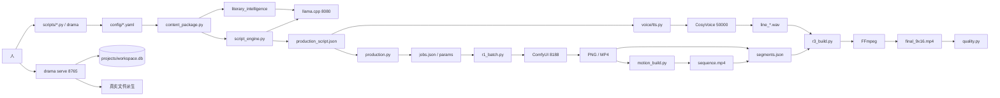

# 架构审计（Phase A）

> 审计日期：2026-11-04
> 基线：`main` / HEAD `06f91e4` + 未提交 M8/声景/zero-shot 工作区
> 目标架构来源：`docs/ARCHITECTURE.md`、`CLAUDE.md`、`docs/PRD.md`
> 判定原则：只按实际代码与真实产物判断；规划中的模块不计入现状。

---

## 1. 结论

| 项 | 结论 |
|---|---|
| 分层是否成立 | **基本成立**：Python 调度、ComfyUI 生成、CosyVoice 语音、llama.cpp 文本、FFmpeg 合成、SQLite 工作台、本地文件资产都在实际运行 |
| 是否存在“ComfyUI 即项目本体” | 否。ComfyUI 只通过 HTTP API 被 `r0_comfy_probe.py` / `r1_batch.py` 调用 |
| 是否有真实端到端 | 有。P1 14.0 s、R3 38.042 s、完整工笔 81.373 s、M7 双片均有过质量门 |
| 是否可复现 | 部分。代码与测试可复跑；R1–R3/S2 的原始实验目录已缺失，历史报告路径不能逐项复跑 |
| 主要架构风险 | 两套数据契约、两套风格系统、TTS 模式静默切换、静态质量门可绕过、工作流 UI 文案过期 |

**一句话**：这不是“文档项目”，核心链路真实跑通过；但它是一个**人工驱动的实验型生产系统**，不是已经封装好的自动化产品。自动化、资产台账、镜头级状态机、发布闭环仍未实现。

---

## 2. 目标架构 vs 实际架构

### 2.1 目标（`docs/ARCHITECTURE.md`）

```text
CLI / Orchestrator
  → Storyboard 数据契约
  → 生成层（ComfyUI 客户端、工作流、缓存）
  → 语音层（CosyVoice 客户端、时间轴）
  → 合成层（FFmpeg 图）
  → 质量门
  → SQLite 状态机 / 断点续跑
```

### 2.2 实际（本机）



### 2.3 目标中“未实现”的部分

```text
comfy_client.py        没有常驻 HTTP/WebSocket 客户端；每次批处理走子进程 probe
generation/            没有工作流渲染/缓存/租约模块
storyboard/            没有独立分镜模块；分镜在 script_engine
character_manager/     没有人物资产 bible/锁
audio/                 没有独立音频包；实际在 voice/
subtitles/             没有独立字幕包；实际在 voice/timeline + r3_build
editing/               没有 FFmpeg 图模块；实际在 r3_build
storage/               没有统一路径/哈希/manifest 模块
orchestrator.py        没有阶段图/断点续跑；实际靠人工脚本与工作台任务
state.py               没有项目级 state.db；实际是 workspace.db + 文件派生
```

---

## 3. 模块边界审计

### 3.1 Python 调度层

**成立的部分**

- `config.py` 统一根目录发现与四份 YAML 加载；`DRAMA_ROOT` 可覆盖。
- `content_package.py` → `script_engine.py` → `production.py` 是清晰的三段式：证据 → 文案/分镜 → 生成输入。
- `production.py` 是唯一把 `ProductionScript` 映射为 ComfyUI jobs / `segments.json` / `motion_shots.json` 的地方；缺图片/音频直接抛 `ProductionError`。
- `quality.py` 独立于构建脚本，检查真实文件而不是相信构建日志。
- `workspace/` 只存用户事实，生产状态由 `discovery.py` 每次请求重新派生。

**不成立/薄弱的部分**

| 编号 | 边界问题 | 证据 | 影响 |
|---|---|---|---|
| B-01 | `models.Storyboard` 是“名义契约”，实际生产用 `ProductionScript` | `models.py:100`；`grep` 只命中测试；`script_engine.py:82` 才是生产模型 | 新开发者可能把 LLM 输出校验到错误模型 |
| B-02 | `config/styles.yaml` 与 `workspace.styles` 是两套风格 | `style_presets.py:380`；`store.py`；`scripts.aesthetic_plan` 用 YAML；`script.generate` 用 DB snapshot | 已加 `styles.preset_id` 与 `_style_lock.preset_id` 映射；UI 创建的 style 仍需显式填 preset_id，motion/aesthetic 其它字段仍不合并 |
| B-03 | 工作台只派生 `narration/segments/audio/build`，不读 `content_package.json` / `production_script.json` | `discovery._analyze_video` | UI “内容/分镜”看不到 LLM 生成的标题、logline、镜头提示词 |
| B-04 | `discovery._workflow` 的节点/文案是旧版 | 已改为 package/static/aesthetic/motion 节点，script/voice 指向真实任务；旧文案删除 | 浏览器截图/点击端到端待做 |
| B-05 | 静态质量门已收口 | `static.check` 任务已注册；`motion.plan` 默认要求报告，缺失即失败 | 真实报告端到端待跑；显式跳过会留痕 |
| B-06 | 运动计划只在特定路径查找静态门 | `production.py:406-407` 只查 `work/static/<shot>/` 与 `static/<shot>/`；aesthetic 的 `static_quality.json` 在 snapshot 下 | 即使已经跑过静态门，plan 也可能找不到而跳过 |
| B-07 | `quality.check` UI 没有 `motion_manifest` 字段 | `tasks.js` quality 表单只有 `manifest`；`QualityParams` 支持两者 | 运动质量门只能走 API/CLI |
| B-08 | `aesthetic.*` 结果不进入派生状态 | `_workflow` 现在读 `aesthetic_plan.json` 作为节点输出；`comparison.json`/人工结论仍无专门视图 | 工作流可见计划，但无 A/B 对比视图 |
| B-09 | `scripts/` 同时是生产适配器与实验工具 | 见 `REPOSITORY_STRUCTURE.md` §3 | 误用实验脚本（如 `pipeline_ink.py`）当生产入口 |
| B-10 | `r3_build.py` 不调用 `quality.py` | `r3_build.py` 内部 ffprobe/解码；`quality.check` 是独立后置 | 直接跑 `r3_build.py` 不会生成 `quality_report.json` |

### 3.2 ComfyUI 生成层

- 调用协议：`scripts/r0_comfy_probe.py` 实现 `POST /prompt` → 轮询 `/history/{id}` → 下载 `/view`；`r1_batch.py` 包一层 jobs/重试/锁。
- 工作流只接受 API 格式；占位符是整值字符串，按 JSON 树替换，数值保持 number。
- 模型：`UnetLoaderGGUF` + `CLIPLoader` + `VAELoader`；文本编码器在 CPU，扩散在 XPU。
- 缺口：没有常驻 `comfy_client.py`；没有 WebSocket 进度；没有跨任务的输出缓存键；没有 `/free` 的主动调用（依赖 ComfyUI 自动卸载）。

### 3.3 CosyVoice 语音层

- `voice/tts.py` 是唯一实现；`scripts/r3_tts.py` 与 `tts.synthesize` 共用。
- 四层文本：`source_text` / `display_text` / `tts_text` / `acoustic_text`；同音别名只改 acoustic。
- 服务契约：`/health`、`/tts`（SFT）或 `/tts/upload`（zero-shot），端口 50000，`trust_env=False`。
- **模式选择（P0-1，PARTIAL）**：`tts.py` 使用显式 `tts_mode`（CLI/任务/narration/config）；调用前校验 `/health` 的 `model_class/model_dir`，SFT 只接受 300M-SFT，zero-shot 只接受 0.5B；manifest 记录实际模型。**PRD 默认是 0.5B zero-shot；当前配置默认仍是 SFT**。
- 服务生命周期：`scripts/cosyvoice_server.ps1` 支持 `cosyvoice2/sft`，但未注册为工作台任务；`who starts, who stops` 规则靠人。

### 3.4 llama.cpp 文本层

- `literary_intelligence/harness/llm_client.py` 提供 OpenAI 兼容客户端；`script_engine.generate_script` 用它做 JSON 输出。
- `run_li15.py` 在服务未启动时调用 `llm_server.ps1 -Action start`，并用 `atexit` 只停自己启动的实例。
- 端口 8080 单实例；`llm_server.ps1` 用模型路径 + 端口 + 无 API Key 判定“自己的进程”。
- 缺口：`workspace.li.run` 未真实执行；`settings.llm.api_key` 固定 `sk-local`；没有请求级配额/超时聚合。

### 3.5 FFmpeg 合成层

- `r3_build.py` 是唯一正式合成脚本；`motion/render.py` 负责镜头级片段；`motion/transition.py` 负责序列转场。
- 关键规范：1080×1920 / 24 fps / H.264 CRF 18 / AAC 192k / mov_text；ASS `PlayRes 1080×1920`；fontselect 强校验。
- 保护：拒绝覆盖已有 `final_9x16.mp4`；工作台总是写 `build-<UTC>`。
- 缺口：`r3_build.py` 的 `--allow-overwrite` 仍可覆盖（需显式传参）；`soundscape` 默认开启会改变音频链路。

### 3.6 SQLite 工作台

- 只存用户事实：projects/episodes/styles/tasks/meta。
- 生产状态：`discovery.py` 从 `narration.json`、`segments.json`、`audio_manifest.json`、`build_manifest.json`、哈希、ffprobe 派生。
- 单飞：`tasks.lock_key` 的 partial unique index。
- 缺口：没有 shot 级状态；没有任务事件表；没有成本/耗时聚合；`styles` 与 YAML 不同步。

### 3.7 本地文件资产

- 路径白名单：`media.safe_path` 只允许 `assets/experiments/projects/literary_intelligence/workflows`。
- 构建隔离：`projects/<project>/episodes/<episode>/renders/build-<time>/`；不覆盖 `experiments/r3b/renders`。
- 缺口：没有统一资产 ID/版本/生命周期；`assets/audio/manifest.json` 是局部清单，不是全局台账。

---

## 4. 数据流审计

### 4.1 P1 真实链路（已验证）

```text
source/ (fixture corpus)
  → content_package.json              [package.build]
  → production_script.json            [script.generate, LLM 8080]
  → narration.json                    [script_engine 附带]
  → audio/line_*.wav + audio_manifest.json [tts.synthesize, CosyVoice 50000]
  → comfy/jobs.json + params          [build_jobs]
  → assets/images/shot_*/shot_*.png   [comfy.batch, ComfyUI 8188]
  → segments.json                     [segments.build]
  → renders/build-<time>/final_9x16.mp4 [build.rebuild, FFmpeg]
  → quality_report.json               [quality.check]
```

### 4.2 Motion 链路（已验证）

```text
production_script.json + assets/images + audio_manifest.json + motion_regions.json
  → motion_shots.json                 [motion.plan, style preset policy]
  → motion/build-<time>/shot_*.mp4 + sequence/sequence.mp4 [motion.render]
  → segments.json (single video)      [segments.build --sequence]
  → r3_build → final_9x16.mp4         [build.rebuild]
  → quality.check
```

约束：序列时长必须 ≥ 旁白时长；转场只消耗上一镜头尾部 handle；`segments.build` 在序列过短时直接失败。

### 4.3 工笔 81.373 s 链路（真实产物，但不在 docs 主索引）

```text
work/source + claims
  → work/content_package.json
  → work/production_script.json (18 行 / 13 镜头)
  → work/narration.json (TTS 简体 / 字幕繁体)
  → work/audio/*.wav + audio_manifest.json (18 句, 中文女)
  → work/assets/images/shot_*/...
  → work/clips/*.mp4 (长卷片段)
  → work/segments.json
  → renders/build-20261103-161945/final_9x16.mp4 (81.373 s)
  → quality_report.json + verification_report.json
```

该链路不是 `motion.plan`，而是 `scroll_shot.py` + 预渲染 clips；这说明“生产链路”目前有**多条并行的实现路径**，不是单一 orchestrator。

### 4.4 数据契约字段（实际）

| 文件 | 顶层字段 | 关键约束 |
|---|---|---|
| `content_package.json` | `schema_version, work, positioning, analysis, video, provenance` | `ContentPackage` 严格模型；`verification_status=draft`；scene/subtitle 数量上限 |
| `production_script.json` | `schema_version, title, logline, lines, shots, style_id, style_sha256, package_sha256, model, generated_at` | 行/镜头引用完整；镜头索引连续；每行至少被一个镜头覆盖 |
| `audio_manifest.json` | `speaker, speed, mode, mode_spec, sample_rate, narration, narration_sha256, endpoint, header, ledger, lines` | 每行 `file/sha256/duration_seconds/pause_after_ms`；header/ledger 可选 |
| `segments.json` | JSON 数组；每项 `id,type,source,duration,line_ids,sha256` | sequence 模式为单元素 `{id:"sequence",type:"video",source,duration,audio_seconds,shots,sha256}` |
| `build_manifest.json` | `segments, content_type, leading_silence_ms, total_seconds, timeline, font, outputs, ffprobe, decode_returncode` | `outputs.final/final_sha256` 是质量门依据 |
| `motion_shots.json` | `{style_id, fps?, shots:[ShotSpec]}` | `ShotSpec` 含 regions/plates/local_motion/transition_in/static_quality |
| `motion_manifest.json` | `shots, sequence, ...` | `motion.render` 后置与 `check_motion_quality` 输入 |

---

## 5. 配置传递审计

| 配置 | 读取者 | 是否真正生效 | 备注 |
|---|---|---|---|
| `settings.paths` | `config.py` | 是 | 相对路径按根解析 |
| `settings.comfyui` | doctor、envprobe | 是（探测） | 生成脚本硬编码 `127.0.0.1:8188`（`r0_comfy_probe.BASE`）；改配置不会改 probe |
| `settings.llm` | `script_engine`、`run_li15`、doctor | 是 | `script_engine` CLI 由 tasks 传 base_url/model/api_key |
| `settings.tts.base_url/sample_rate` | `tts.py` | 是 | `settings.tts.mode` 已删除；默认模式在 `audio.yaml` |
| `settings.ffmpeg` | doctor、quality | 是 | `r3_build.py` 直接用 `ffmpeg`/`ffprobe` 字符串，不读 binary 配置 |
| `audio.tts.mode` / `default_speaker` | `tts.py` | 是 | PRD 目标 `zero_shot`；当前 `sft`（不符 PRD）；CLI/任务 `tts_mode` 显式覆盖 |
| `audio.speakers` | `_default_speaker` | 是（仅 SFT） | zero-shot 时不使用 |
| `audio.narration_modes.*` | `recitation.py` | 部分 | `speed/line_pause_ms/intra...` 生效；`leading_ms` 未被 r3_build 消费 |
| `audio.subtitles.*` | 无 | **否** | 死配置 |
| `audio.loudness.*` | `soundscape.py` | 是（soundscape enabled 时） | soundscape 关闭时 `r3_build` 硬编码 -16/-1.5/LRA 11 |
| `audio.soundscape.*` | `soundscape.py` | 是 | 当前 enabled=true |
| `styles.*` | `style_presets`、`motion`、`aesthetics` | 是 | 仅 YAML preset；workspace DB 风格不参与 |
| `pronunciation.*` | `pronunciation.py` | 是 | verified/candidate 状态影响报告 |
| `fonts.*` | `fonts.py`、`r3_build` | 是 | 字幕角色正式接入；其他角色 preview_only |
| `generation.profiles` | 无生产消费者 | **否** | 生产参数在 `production.build_jobs` 默认值 |
| `models.*` | doctor | 是（校验） | 生成工作流节点里写死文件名 |

---

## 6. 状态管理审计

### 6.1 两套状态

| 状态 | 存放 | 例子 |
|---|---|---|
| 用户事实 | `workspace.db` | 项目、期数、风格、任务参数/结果/日志路径 |
| 生产状态 | 文件派生 | 期数进度、步骤状态、成片存在/哈希、素材扫描 |

设计原则“UI 不发明状态”基本成立：`discovery` 的 `PASS_VERIFIED` 需要文件/哈希/ffprobe 证据。

### 6.2 不成立的部分

- **没有镜头级状态机**：`models.ShotStatus` 只是枚举；没有 `shots` 表、没有迁移、没有事件日志。`docs/ARCHITECTURE.md` §6 的状态机是目标，不是现状。
- **没有断点续跑**：`r1_batch.py` 有 job 级 skip；工作台任务没有“从失败步骤继续”的语义；`p1_e2e --resume` 只是复用脚本。
- **任务状态与产物状态可能不一致**：任务 `FAILED` 但产物已生成（P1 `script.generate` 是实例）；任务 `SUCCEEDED` 但后续产物被手动删除时，`discovery` 会降级。
- **样式漂移检测只比较 `updated_at`**：`_style_view.drifted` 用时间戳，不比较内容哈希。

---

## 7. 错误传播与重试

| 层 | 机制 | 限制 |
|---|---|---|
| `script_engine` | LLM 输出 Schema 失败 → 把错误回给 LLM → 最多 3 次（`for attempt in range(3)`，即初次 + 2 次修复） | 失败保留 `script_raw_attempt*.json`；HTTP 失败直接抛，不重试 |
| `r1_batch` | 每个 job 最多 3 次（初次 + 2 重试）；失败写 `job.json`；成功需输出哈希仍匹配 | 无指数退避；重试间隔立即 |
| `TaskRunner` | 子进程退出码 + 后置校验；失败写日志尾 | 后置校验异常会把 exit 0 的任务标 FAILED（P1 实例） |
| `r3_build` | 命令失败抛 RuntimeError；拒绝覆盖；ffprobe/解码失败返回 1 | 没有自动清理半成品；半成品留在 build 目录 |
| `motion.render` | 静态门 FAIL 直接拒绝；局部层被区域合同拒绝时跳过该层 | 跳过不会让镜头失败，只记录 `skipped` |
| `workspace` | `TaskError` → HTTP 4xx；未知异常 → 500 | 进程崩溃后只能靠 `recover_stale_tasks` 标失败 |
| `quality` | 独立报告；不删除产物 | 旧 `quality_report.json` 会被新检查覆盖（同一目录） |

---

## 8. GPU 互斥与服务依赖

### 8.1 GPU

- 8 GB A750 是独占资源。实际约束：
  - `r1_batch.py` 文件锁 `gpu-comfy.lock`；
  - workspace `comfy.batch` 的 `lock_key="gpu:comfy"`；
  - `doctor` 只探测，不占 GPU；
  - `start.ps1` 不检查显存，只检查端口。
- 缺口：没有运行时显存租约；没有“FLUX/Wan/LLM 同时启动”的拒绝逻辑；LLM 是 CPU-only，但会占 ~19 GB RAM。

### 8.2 服务

| 服务 | 端口 | 启动者 | 停止规则 |
|---|---|---|---|
| ComfyUI | 8188 | `start.ps1` / `service.comfy.start` | `stop.ps1` 只杀 `runtime\ComfyUI` 进程树 |
| llama.cpp | 8080 | `llm_server.ps1` / `run_li15.py` | 只停自己启动的实例（模型路径 + 端口 + 无 API Key） |
| CosyVoice | 50000 | `cosyvoice_server.ps1` / 人工 | 只停 `D:\AI\CosyVoice-Runtime` 下的 python |
| 工作台 | 8765 | `drama serve` | Ctrl+C |

`doctor`/`envprobe` 对未监听服务返回 `NOT_RUN`，不猜测。这个规则执行得很好。

---

## 9. 文件读写与历史隔离

**成立**

- `build.rebuild` 写 `projects/<project>/episodes/<episode>/renders/build-<UTC>/`；同名目录存在时拒绝。
- `r3_build.py` 默认拒绝覆盖 `final_9x16.mp4`；`--allow-overwrite` 是显式逃生门。
- `aesthetic.plan` 每次写新的 `snapshot-<time>`；`build_aesthetic_jobs` 拒绝非空 snapshot。
- `motion.render` 写新的 `motion/build-<time>/`。
- `media.safe_path` 路径白名单阻止 `..`、绝对路径、盘符。

**不成立/薄弱**

- `quality.check` 写 `quality_report.json` 到 manifest 同目录，会覆盖旧的同目录报告；没有版本号。
- `r3_build` 的 `--allow-overwrite` 仍可覆盖历史（人工显式）。
- `workspace.tasks` 的 `after_success` 用“最新 mtime 的 build_manifest”推断刚完成的构建；并发/时钟异常时可能选错目录。
- `discovery._collect_builds` 用 mtime/目录名排序；旧 manifest 缺字段时标 `legacy`，但仍展示。

---

## 10. 架构风险清单

| 编号 | 风险 | 严重度 | 证据 | 建议方向（不在本轮实施） |
|---|---|---|---|---|
| A-01 | TTS 模式静默切换 | **PASS_VERIFIED（P0-1）** | 默认 0.5B zero-shot + 显式 `tts_mode` + `/health` 校验 + manifest 记录；默认任务真实 1 行 | 保持 |
| A-02 | 静态质量门可绕过：不在任务注册表，plan 只查两个固定路径 | **中（已收口）** | `build_motion_plan` 默认要求每镜头报告，缺失即失败；`--skip-static-gate` / 任务 `skip_static_gate` 显式跳过；单测覆盖 | 补 `static.check` 任务与真实端到端；不再允许静默继续 |
| A-03 | 工作流 UI 文案过期，且不显示 package/script/motion/aesthetic 节点 | **高** | `discovery.py:1061-1062,1082` | 重写 `_workflow` 节点/边；从真实任务注册表生成 |
| A-04 | 两套风格系统：DB 快照 vs YAML preset | **中（部分收口）** | `style_lock.py` 锁定期数 snapshot（revision/hash/history），任务不能覆盖；DB 与 YAML preset 仍是两套定义 | 建立 preset id 单一来源或显式映射；补真实改版生产 |
| A-05 | 两套数据契约：Storyboard vs ProductionScript | **中** | `models.py:100`；`script_engine.py:82` | 文档标注 Storyboard 为 legacy/目标；或统一到一个契约 |
| A-06 | 配置死字段：`tts.mode`、`subtitles.*`、`narration_modes.leading_ms`、`generation.profiles` | **中** | `config/audio.yaml`、`config/generation.yaml`；grep 无消费者 | 要么接线，要么删字段并在文档标注“仅记录” |
| A-07 | 运动质量门无法从 UI 选 | **中** | `tasks.js` quality 表单 | 加 `motion_manifest` 字段 + 自动找最新 motion manifest |
| A-08 | 美学层结果不进入派生状态 | **中** | `discovery.py` 不读 aesthetic | 加 `aesthetic` 派生视图/API |
| A-09 | 任务注册表不是唯一执行路径；TTS/LLM 无跨进程锁 | **中** | `scripts/r3_tts.py` 可直接跑；`locks.py` 只用于 GPU | 统一入口或给 TTS/LLM 加锁 |
| A-10 | 证据路径腐烂：R1–R3/S2 run 目录缺失 | **中** | `experiments/r0..r3b` 等不存在 | 修复文档路径；保留本地证据清单；不要伪造路径 |
| A-11 | 文档状态矛盾：S3 PARTIAL vs NOT_RUN；M8-E 重复；`validation_status` | **中（已部分收敛）** | `config/styles.yaml` 已改 `PARTIAL`；README/ROADMAP 仍可能有过期快照 | 继续按证据巡检 |
| A-12 | doctor 不校验 styles/pronunciation/fonts | **中低** | `doctor._config_checks` 只 4 份 | 扩展 `cfg.load` 或新增检查 |
| A-13 | 81.373 s 工笔成片未进主索引 | **中低** | `projects/.../build-20261103-161945/`、`PRODUCTION_REPORT.md` | 纳入文档与案例库 |
| A-14 | ContentPackage/ProductionScript 不在工作台内容视图 | **中低** | `discovery._video_content` 只读 narration | 增加只读视图/链接 |
| A-15 | `quality_report.json` 覆盖式写入 | **低** | `quality.check_build` | 写带时间戳的报告或保留历史 |
| A-16 | `generation.profiles` 与生产参数脱节 | **低** | `production.build_jobs` 默认值 | 让 jobs 从配置读取，或删 profile |
| A-17 | 无统一成本/失败率监控 | **低** | `logs/` 分散 | M5 批处理前再做 |

---

## 11. 架构审计结论

1. **分层是真实的**：Python 调度、ComfyUI、CosyVoice、llama.cpp、FFmpeg、SQLite、本地文件各自有清晰入口，未出现“ComfyUI 吞掉业务逻辑”。
2. **状态原则是真实的**：工作台不把生产状态写库，`discovery` 从文件派生；`doctor` 不猜测。
3. **最大问题不是“缺模块”，而是“同一能力有多条路径”**：两套契约、两套风格、CLI 与工作台、静态门与运动门。它们各自能跑，但组合起来会产生“文档说 A、实际走 B”的偏差。
4. **A-01 已修复；A-02/A-03 已收口**；下一步是浏览器端到端、`comfy.batch` 风格校验真实任务与跨镜头一致性门。
5. **历史证据需要重新索引**：不是重跑全部实验，而是把仍存在的产物、报告、缺失路径如实标注，避免以后把报告路径当成可复跑入口。

---

## 12. 2026-11-04 产品决策修正

以下决策由项目所有者确认。TTS 的模式管线/校验/记录与默认 0.5B 切换均已完成（`PASS_VERIFIED`）；多音色档案 `PRD-TTS-007` 为提案阶段实现。双视觉风格仍为现状对照。

### 12.1 TTS：默认 0.5B zero-shot，SFT 显式可选（PASS_VERIFIED）

| 项 | 产品目标 | 当前实现 | 结论 |
|---|---|---|---|
| 默认模式 | **CosyVoice2-0.5B zero-shot** | `config/audio.yaml` `tts.mode: zero_shot`；默认任务真实 0.5B 1 行 PASS | 满足 |
| 默认音色 | zero-shot 参考音 | `zero_shot.prompt_audio` 默认使用；manifest 记录 prompt | 满足 |
| SFT | 仅显式可选，不得默认 | `--tts-mode sft` / 任务 `tts_mode`；`/health` 校验 `CosyVoice` + `CosyVoice-300M-SFT` | 满足 |
| 可识别性 | UI/CLI/任务/manifest 记录 mode/model/voice | CLI/任务结果 + manifest 的 `tts_mode/model_class/model_dir/speaker/speaker_id/runtime/prompt`；多音色含 `voice_cast` 与逐行字段 | 满足 |
| 错配处理 | 不得静默切换 | SFT↔zero-shot 双向错配直接报错 | 满足 |
| 真实验证 | 两种模式各跑通 | 2026-11-04 默认 zero-shot 2 行 + 显式 SFT 1 行；2 行 `voice_profile` 真实 PASS | 满足 |

已核实的真实模型映射（只读检查 `D:\AI\CosyVoice-Runtime`）：

```text
start_cosyvoice_sft.bat  -> COSY_MODEL_CLASS=CosyVoice   + CosyVoice-300M-SFT -> inference_sft()
start_cosyvoice.bat      -> COSY_MODEL_CLASS=CosyVoice2  + CosyVoice2-0.5B    -> inference_zero_shot()
```

同一端口 50000，两个运行时互斥。`api_server.py` 的 `/tts` 以 `speaker` 非空为 SFT 分支，否则 zero-shot；`/health` 返回 `model_class/model_dir/speakers/modes`。代码调用前校验实际模型，并把结果写入 manifest。

### 12.2 双视觉风格：作品级主风格与一致性约束

产品目标：

1. 每个作品选择一个主视觉风格（青绿工笔 / 写意水墨）；
2. 第一帧到最后一帧保持该风格，不混用；
3. 不同作品可分别使用不同风格；
4. 同风格内部允许景别/构图/色彩/光影/运镜变化；
5. 两种风格共享 FLUX/Wan/FFmpeg 基础设施，但拥有独立规范、提示词、参数与质量评价；
6. 风格是作品级配置：期数、`ProductionScript`、镜头、视觉资产继承 `style_id`；
7. 生成任务不得自行覆盖或切换作品风格；
8. 改风格必须创建新风格版本或新生产版本并记录；
9. 质量检查应能检查风格一致性。

当前实现与差距：

| 目标 | 当前 | 结论 |
|---|---|---|
| 作品级 `style_id` | 期数有 `style_id` + `style_snapshot`；项目有 `default_style_id` | 部分成立 |
| `ProductionScript` 继承 | 记录 `style_id` + `style_sha256` | 成立（提示词层） |
| 镜头/资产继承 | 镜头只存 `visual_prompt`，没有 `style_id` 字段 | 部分成立 |
| 生成任务不得覆盖 | `motion.plan` / `aesthetic.plan` 有 `--style` 覆盖；`comfy.batch` 不校验 | **不成立** |
| 改风格留版本 | UI 直接替换期数 snapshot；无版本表/历史链 | **不成立** |
| 风格一致性质量门 | `static_quality` 按单图风格检查；`check_color_continuity` 只查相邻镜头 LAB/亮度；无跨镜头风格分类/门 | **不成立**（仅部分客观指标） |
| DB/YAML 统一 | `workspace.styles` 不含 motion/compositing/aesthetic_profile；`config/styles.yaml` 才是运动/美学 preset | **脱节** |

### 12.3 S3 按三件事分别评价

| 评价项 | 状态 | 依据 |
|---|---|---|
| 1. 两种风格是否已建立独立规范和配置 | **PASS_STATIC** | `config/styles.yaml` 两套 `visual_language/positive_prompt/material/line/detail/motion/compositing/aesthetic_profile`；`style_presets.py` 严格校验；8 项测试 |
| 2. 两种风格是否分别完成技术生产验证 | **PASS_VERIFIED（技术样片）** | `experiments/m7_final/ink` 10.087 s、`court` 9.583 s；`quality_report` PASS、audio QA PASS；M7 报告记录人工审片通过 |
| 3. 单篇作品是否具备作品级风格锁定 + 跨镜头一致性验证 | **PARTIAL（锁定机制）/ NOT_RUN（正式一致性验证）** | 期数 snapshot + ProductionScript `style_id/style_sha256` 存在；但任务可覆盖、DB/YAML 脱节、无风格一致性门；81.373 s 工笔是 `scroll_shot.py` + 预渲染 clips，不是 `motion.plan` 路径 |

> M7 只能证明“每种风格各有一个 2 镜头技术样片”；不能证明完整作品的跨镜头风格一致性。81.373 s 工笔是更长的生产案例，但实现路径不同，也不能替代 `motion.plan` 的一致性或自动运动验证。
