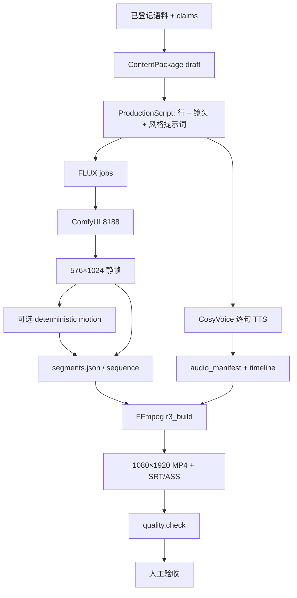
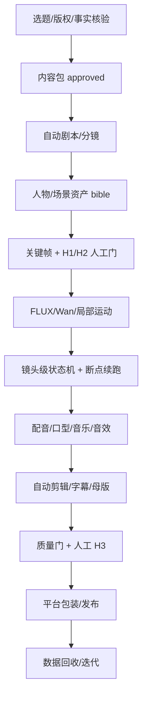

# Phase A 审计汇总（给审阅）

> 日期：2026-11-04
> 范围：只读审计；未修改业务代码、配置、生产数据或实验产物。
> 产物：
> - `docs/audit/REPOSITORY_STRUCTURE.md`
> - `docs/audit/IMPLEMENTATION_STATUS.md`
> - `docs/audit/ARCHITECTURE_AUDIT.md`
> - 本文件

---

## 0. 一句话结论

**项目不是空壳，核心生产链路真实跑通过；但它目前是“人工驱动的实验型生产系统”，不是已经封装好的自动化产品。**

本机可核验的真实成片：

| 案例 | 规格 | 证据 |
|---|---|---|
| P1 端到端 | 14.0 s / 1080×1920 / 4 静帧 / 4 句女声 | `projects/proj_p1_short/.../build-20261103-114226/` |
| R3 单篇 | 38.042 s / 1080×1920 / 5 静帧 + 1 Wan / 7 句 | `projects/proj_chunjiang/.../build-20261103-074757/` |
| 完整工笔 | 81.373 s / 1080×1920 / 13 段 / 18 句 | `projects/proj_chunjiang_gongbi/.../build-20261103-161945/` |
| M7 水墨 | 10.087 s | `experiments/m7_final/ink/renders/` |
| M7 工笔 | 9.583 s | `experiments/m7_final/court/renders/` |

全部有 `quality_report.json` PASS；工笔 81 s 还有 `verification_report.json` PASS 与 SHA-256 `84628a06…` 一致。

测试：审计时 **323 passed**；Phase C P0-1 后 **325 passed**；后续多音色/故事圣经批次 **377 passed**。`doctor`：**15 PASS_VERIFIED / 3 NOT_RUN / 0 FAIL**（三个服务未启动）。

---

## 1. 初步生产管线图

### A. 当前已验证的单篇竖屏生产管线



- 已验证：P1 14.0 s、M7 双片、工笔 81.373 s。
- 已验证但非同一路径：工笔 81 s 用 `scroll_shot.py` + 预渲染 clips，不是 `motion.plan`。
- 质量门：技术门 PASS；运动/美学/发音仍 `PARTIAL` 或 `PENDING_HUMAN_REVIEW`。

### B. 已实现但尚未完整验证的生产能力


- 状态：A/B 8 张实图、联系表、自动指标已生成；人工结论 `PENDING_HUMAN_REVIEW`。
- 2.5D plates：`PlateSpec` + `motion/plates.py` + `_render_layered_shot` 已落地，13+ 单元测试与真实渲染 PASS；但仍是 opt-in，未成为默认生产路径。
- 声景：`soundscape.py` + `config/audio.yaml` 已开启，zero-shot E2E 有 `mixed_mastered.wav`；BGM/环境音未接入。
- zero-shot TTS：2 行 E2E（`experiments/audio_probe/zeroshot_e2e`）；未进入正式成片。
- LI 五轮：真实 LLM 运行记录在 `literary_intelligence/runs/`；人工审核 `NOT_RUN`。

### C. 未来完整 AI 短剧生产管线（未实现）



**这张图不是现状。** 未实现：镜头级状态机、断点续跑、人物一致性、口型、自动发布、数据闭环、批处理调度；`models.Storyboard` 也只是未消费的契约。

---

## 2. 文档与代码差异（按影响排序）

| # | 文档说法 | 代码/产物实际 | 影响 |
|---|---|---|---|
| D-01 | `docs/README.md:68` 说 S3 `PARTIAL`（两风格各 2 镜头走通） | `docs/ROADMAP.md:54` 与 `docs/PRD.md:711` 说 S3 `NOT_RUN` | 同一能力三种状态，无法判断是否可依赖 |
| D-02 | `docs/ROADMAP.md:85` M8-E `PASS_STATIC` | 同文件 `:91` 又有 M8-E `NOT_RUN` | 重复条目、互相矛盾 |
| D-03 | `config/styles.yaml:28,199` 两风格 `validation_status: NOT_RUN` | S2 技术通过、M7 两片人工通过 | 配置状态落后于报告 |
| D-04 | CLAUDE.md / ARCHITECTURE 把 `Storyboard` 写成数据契约边界 | `models.Storyboard` 只被测试使用；生产用 `ProductionScript` | 新开发者容易接错模型 |
| D-05 | 工作流页写“写入路径未实现”“分镜生成器未实现”“r3_tts.py 尚未参数化” | `package.build` / `script.generate` / `tts.synthesize` 已真实执行 | UI 自相矛盾，用户会以为功能不存在 |
| D-06 | `docs/ENVIRONMENT.md` 把文本编码器/VAE 标为“待下载” | `doctor` 显示 3+3 个文件、10.23/10.78 GiB，大小校验通过 | 环境文档过期 |
| D-07 | `docs/WORKSPACE_REPORT.md` 记 44 + 61 测试；`docs/M8_0_STATE_AUDIT.md` 记 246；`docs/PRD.md` §21 记 136 | 审计时 **323**；Phase C P0-1 后 **325**；后续批次 **377** | 测试基线不可信 |
| D-08 | `workflows/README.md` 列出 5 个不存在的 `flux_*` / `wan_*` 文件 | 实际是 `r0_*` / `r1_*` | 命名表是目标，不是现状 |
| D-09 | 根 README/CLAUDE 只列 P1 14 s、R3 38 s | 本机还有 81.373 s 工笔完整成片 | 低估了现有生产能力 |
| D-10 | `docs/README.md` 未索引 M8/声景/zero-shot | 工作区已有对应代码/文档 | 新接手者看不到最新工作 |
| D-11 | `literary_intelligence/README.md` 说“不接入视频生产链路” | `content_package.py` 已把 LI 证据接到 `package.build`（视频期数） | LI 边界描述过期 |
| D-12 | `docs/ARCHITECTURE.md` §6 描述镜头状态机 | 只有 `ShotStatus` 枚举，没有持久化/迁移 | 目标设计被误读为现状 |

---

## 3. 主要问题清单（初步，Phase C 再排期）

### P0：会让“用户以为在做什么”与“实际在做什么”不一致

| 编号 | 问题 | 证据 | 为什么是 P0 |
|---|---|---|---|
| P0-1 | TTS 模式静默切换 | **PASS_VERIFIED（P0-1）**：默认 0.5B zero-shot；显式 `--tts-mode`、`/health` 校验、manifest 记录 | 默认 zero-shot 1 行 + 显式 SFT 1 行；双向错配拒绝 |
| P0-2 | 静态质量门可绕过：`static_quality.py` 不在任务注册表，`motion.plan` 只查两个固定路径 | `scripts/static_quality.py` 仅 CLI；`production.py:406-407`；`render.py:143-150` 只在 `shot.static_quality` 非空时检查 | 文档说“先过静态门再动”，实际可以完全跳过 |
| P0-3 | 工作流页文案过期且缺节点 | `discovery.py:1061-1062,1082` | UI 是最直观的状态来源；它会直接误导操作 |
| P0-4 | 两套风格系统：UI 改风格不影响运动/美学 | `style_presets.py:380` vs `store.py:60-80`；P1 `style_p1_short` 不是 YAML preset | 用户会以为改了风格，实际生成策略没变 |

### P1：完成现有单篇闭环必须处理

| 编号 | 问题 | 证据 |
|---|---|---|
| P1-1 | TTS 模式已接线（P0-1）；剩余死配置：`subtitles.*`、`narration_modes.leading_ms`、`generation.profiles` | grep 无消费者；见 `ARCHITECTURE_AUDIT.md` §5 |
| P1-2 | `quality.check` UI 不能选 motion manifest | `tasks.js`；`QualityParams` 支持但表单只给 `manifest` |
| P1-3 | 美学 A/B 结果不进入派生状态 | `discovery.py` 不读 `aesthetic_plan.json`/`comparison.json` |
| P1-4 | 工作台“新生成”路径在修复后未实证 | P1 成功记录用 `--reuse`；真实 LLM 任务被标 FAILED |
| P1-5 | 历史证据路径腐烂 | `experiments/r0..r3b`、`s2a/s2b` 不存在 |
| P1-6 | 文档状态矛盾 | D-01/D-02/D-03 |
| P1-7 | 81.373 s 工笔成片审计时未进主索引（Phase B 已补入） | `projects/.../build-20261103-161945/` |
| P1-8 | `doctor` 不校验 styles/pronunciation/fonts | `doctor._config_checks` |

### P2：效率、复用、质量提升

- 统一资产台账/版本号（当前只有 `assets/audio/manifest.json` 局部清单）。
- 成本/失败率聚合（当前日志分散）。
- 任务事件表/镜头级状态（当前无）。
- `r3_build` 报告版本化，避免 `quality_report.json` 覆盖。
- `generation.profiles` 接线，或删除并在文档标注。

### P3/P4：完整短剧、商业化

- 人物一致性、口型、多镜头连续动作。
- 夜间批处理（M5）、平台发布/数据（M4/M6）。
- BGM/SFX 授权、商用声音授权。
- 自动发布与多用户（v1.0 明确不做）。

---

## 4. 已确认的产品决策（2026-11-04）

以下三项已由项目所有者确认，Phase B 按此执行；Phase C 再改代码/配置：

1. **TTS 默认改为 CosyVoice2-0.5B zero-shot**（2026-11-04 最新 PRD，覆盖此前 SFT 默认决定）
   - 默认模式：**CosyVoice2-0.5B zero-shot**。
   - 300M SFT 保留为**显式可选**模式，不得默认。
   - UI、CLI、任务记录、`audio_manifest.json` 必须能识别实际 mode/model/voice。
   - **已落地**：`audio.yaml` 默认 `zero_shot`；默认任务真实 0.5B 1 行；SFT 显式 1 行；`/health` 校验与 manifest 记录已实现。
2. **81.373 s 工笔成片纳入正式生产案例**
   - 路径：`projects/proj_chunjiang_gongbi/episodes/ep_chunjiang_gongbi_01/renders/build-20261103-161945/`。
   - 81.373 s / 1080×1920 / 13 段 / 18 句；`quality_report` PASS、`verification_report` PASS、SHA-256 已核对。
   - 实现方式：**`scroll_shot.py` + 预渲染 clips**，不是 `motion.plan` 自动运动管线；文档必须与 R3/P1 路径分开描述。
3. **双视觉风格是正式产品能力**
   - 每个作品选择一个主风格；全片不混用；不同作品可分别使用不同风格。
   - 风格是作品级配置；期数、`ProductionScript`、镜头、视觉资产继承 `style_id`；生成任务不得覆盖。
   - 改风格要创建新风格版本或新生产版本并记录。
   - 质量检查应能检查风格一致性。
   - 当前代码**尚未完全满足**：`motion.plan`/`aesthetic.plan` 可 `--style` 覆盖，`comfy.batch` 不校验；DB 风格与 YAML preset 脱节；改风格直接替换 snapshot，无版本链；无跨镜头风格一致性门。

### S3 状态（按三件事分别评价，不再用单一状态概括）

| 评价项 | 状态 | 依据 |
|---|---|---|
| 两种风格是否建立独立规范和配置 | **PASS_STATIC** | `config/styles.yaml` + `style_presets.py` + 8 项测试 |
| 两种风格是否分别完成技术生产验证 | **PASS_VERIFIED（技术样片）** | M7 水墨 10.087 s、工笔 9.583 s；quality/audio QA PASS；M7 人工审片记录 |
| 单篇作品是否具备作品级风格锁定 + 跨镜头一致性验证 | **PARTIAL（锁定机制）/ NOT_RUN（正式一致性验证）** | 有期数 snapshot + ProductionScript style_id/hash；但任务可覆盖、DB/YAML 脱节、无风格一致性门；81.373 s 工笔是 scroll_shot 路径 |

> M7 只能证明每种风格各有一个 2 镜头技术样片；不能证明完整作品的跨镜头风格一致性。

---

## 5. 尚未确认（UNKNOWN）

- R1/R2/R3/S2 原始 run 是否能按报告路径复跑（目录缺失）。
- 浏览器 34 项 E2E 是否仍全过（历史报告，脚本未入库）。
- 工作台新生成路径在修复后是否稳定（最近成功是 `--reuse`）。
- zero-shot 完整成片听感（只有 2 行 E2E）。
- 完整 18 联 ContentPackage 是否超 schema 上限（未生成）。
- 2.5D plate 路径在长镜头/多镜头中的稳定性（有真实渲染 PASS，但 opt-in）。

---

## 6. Phase B 结构与执行状态（已确认，开始执行）

```text
docs/
├─ audit/                          # 本轮已建
│  ├─ REPOSITORY_STRUCTURE.md
│  ├─ IMPLEMENTATION_STATUS.md
│  ├─ ARCHITECTURE_AUDIT.md
│  └─ PHASE_A_SUMMARY.md
├─ PROJECT_OVERVIEW.md             # 产品是什么、能做什么、不能做什么
├─ PRODUCTION_PIPELINE_GUIDE.md    # 阶段 A/B/C、输入输出、命令、失败恢复
├─ USER_GUIDE.md                   # 从零到一篇成片
├─ PRODUCTION_CONFIG_GUIDE.md      # 实际配置 vs 推荐 vs 未验证
├─ DEVELOPER_GUIDE.md              # 架构、扩展、测试、工作流接入
├─ TROUBLESHOOTING.md              # 故障树
└─ PROJECT_NEXT_STEPS.md           # P0-P4
```

Phase B 只改文档；所有命令会先用真实代码/脚本核实，不猜参数。Phase C 再按 `PROJECT_NEXT_STEPS.md` 一次处理一个任务。

---

## 7. 本轮实际写入

```text
docs/audit/REPOSITORY_STRUCTURE.md
docs/audit/IMPLEMENTATION_STATUS.md
docs/audit/ARCHITECTURE_AUDIT.md
docs/audit/PHASE_A_SUMMARY.md
```

未修改：`src/`、`scripts/`、`config/`、`workflows/`、`tests/`、`projects/`、`experiments/`、`assets/`、`logs/`、根 README、`docs/README.md`。

Phase A 结论与三项产品决策已确认；Phase B 只修改文档，不修改业务代码/配置/生产数据。
