# 仓库结构审计（Phase A）

> 审计日期：2026-11-04
> 审计基线：分支 `main`，HEAD `06f91e4`（`feat(pipeline): complete M1-M7 motion refactor...`）
> 工作区状态：**非干净**。17 个已跟踪文件被修改，23 个新文件/目录未跟踪（详见 §0.3）。
> 审计方式：静态阅读源码、配置、测试、工作流与文档；实际运行 `pytest`；实际运行只读 `doctor`；对真实产物做哈希/ffprobe 核验。
> 本轮性质：**只读审计**。除本目录文档外，未修改任何业务代码、配置、生产数据或实验产物。

---

## 0. 审计基线

### 0.1 Git 与测试

| 项 | 实际值 |
|---|---|
| 分支 | `main` |
| HEAD | `06f91e418364344058c8428c0136e3b81ba58c1e` |
| 最近提交时间 | 2026-11-04 12:03:02 +0800 |
| 测试命令 | `.venv\Scripts\python.exe -m pytest` |
| 测试结果 | **378 passed**（后续多音色/故事圣经批次；审计时为 323；根测试 + `literary_intelligence/tests` 合并） |
| 采集总数 | `pytest --collect-only` 合计 378 |
| 已知警告 | `StarletteDeprecationWarning`：`httpx` + `starlette.testclient` 弃用提示 |

> 历史文档中的测试数已过期：`docs/M8_0_STATE_AUDIT.md` 记 246，`docs/PRD.md` §21 记 136，`docs/WORKSPACE_REPORT.md` 记 44 + 61。审计时真实值是 323；Phase C P0-1 新增 2 项 TTS 测试后为 325。

### 0.2 当前环境（只读探测）

| 项 | 实际值 | 证据 |
|---|---|---|
| Python（调度环境） | 3.12.10 | `.venv\Scripts\python.exe` |
| uv | 0.10.8 | `uv --version` |
| FFmpeg / ffprobe | 8.1-full_build（gyan.dev） | `ffmpeg -version` |
| ComfyUI 安装 | 存在，`runtime/ComfyUI/main.py` | `doctor` `comfy.install` |
| PyTorch XPU | `2.15.0+xpu`，1 个 XPU：Arc A750 | `doctor` `comfy.xpu` |
| FLUX 模型 | 3 个文件，10.23 GiB，大小校验通过 | `doctor` `model.flux_2_klein_4b` |
| Wan 模型 | 3 个文件，10.78 GiB，大小校验通过 | `doctor` `model.wan_2_2_ti2v_5b` |
| 根 `.venv` 是否装 torch | **否**（`ModuleNotFoundError: torch`） | 双环境边界成立 |
| 端口 8188 / 8080 / 50000 / 8765 | 审计时全部未监听 | TCP 探测 |
| `doctor` 汇总 | 15 `PASS_VERIFIED`，3 `NOT_RUN`（三个服务），0 `FAIL` | `drama doctor --json --no-report` |

### 0.3 工作区未提交内容

已修改（17）：

```text
config/audio.yaml
config/settings.yaml
config/styles.yaml
docs/ASSET_AND_LICENSE_REGISTRY.md
docs/ROADMAP.md
docs/VISUAL_STYLE_SPEC.md
scripts/r3_build.py
src/drama_studio/config.py
src/drama_studio/motion/render.py
src/drama_studio/motion/spec.py
src/drama_studio/production.py
src/drama_studio/quality.py
src/drama_studio/style_presets.py
src/drama_studio/voice/tts.py
tests/test_production.py
tests/test_style_presets.py
tests/test_voice_tts.py
```

未跟踪（23 项，含目录）：

```text
assets/audio/
docs/AUDIO_ASSET_STRATEGY.md
docs/AUDIO_SOUNDSCAPE_PLAN.md
docs/M8_0_STATE_AUDIT.md
docs/M8_A_PARALLAX_REPORT.md
docs/M8_B1_PLATE_SOURCE_REPORT.md
docs/M8_B2_ASSET_LAYER_REPORT.md
docs/M8_B3_TARGET_SHAPE_REPORT.md
scripts/cosyvoice_server.ps1
scripts/m8_parallax.py
scripts/m8_plates.py
scripts/make_ir.py
scripts/ng_probe.py
scripts/voice_prompt_check.py
src/drama_studio/motion/plates.py
src/drama_studio/voice/soundscape.py
src/drama_studio/voice/zeroshot.py
tests/test_motion_plates.py
tests/test_motion_plates_compose.py
tests/test_quality_plates.py
tests/test_soundscape.py
tests/test_voice_prompt.py
workflows/m8_flux2_inpaint_api.json
```

含义：HEAD 是 M1–M7 基线；当前工作区已经包含 M8 的 2.5D 分层代码、声景母带、zero-shot TTS 和音频素材策略。**不能把 HEAD 当成当前全部能力的边界。**

---

## 1. 顶层目录树

```text
Local-Drama-Studio/
├─ .github/workflows/             # 通用 CI 模板（与本项目业务无关）
├─ .venv/                         # 调度环境（Python 3.12，无 torch；本地、忽略）
├─ assets/                        # 视觉/字体/音频素材（部分忽略）
│  ├─ audio/                      # 声景 IR、zero-shot 参考音、素材清单
│  ├─ fonts/                      # 字体 manifest/LICENSE + 本地 OTF
│  ├─ keyframes/                  # R1 四张 16:9 关键帧 + meta（本地、忽略）
│  ├─ vertical/                   # R3-A 五张竖屏静帧 + 一段 Wan（本地、忽略）
│  └─ visual_style/               # 风格圣经、J2 参考图、场景图（本地、忽略）
├─ config/                        # 8 份 YAML 配置
├─ docs/                          # 产品文档、技术报告、工作台文档
├─ experiments/                   # 实验产物与真实生成证据（本地、忽略）
├─ literary_intelligence/          # 独立文学证据链包（语料 + harness + 运行记录）
├─ logs/                          # doctor/服务/任务/锁日志（本地、忽略）
├─ projects/                      # SQLite 工作台 + 真实项目/期数产物（本地、忽略）
├─ runtime/ComfyUI/               # 独立生成环境（本地、忽略）
├─ scripts/                       # 生产适配器、实验工具、服务脚本
├─ src/drama_studio/              # 生产 Python 包
├─ tests/                         # 根测试套件
├─ workflows/                     # ComfyUI API 格式工作流
├─ CLAUDE.md                      # 项目约束与当前状态
├─ README.md                      # 产品入口文档
├─ pyproject.toml / uv.lock       # 调度环境依赖
└─ .gitignore                     # 仓库边界
```

---

## 2. `src/drama_studio/` 模块地图

### 2.1 核心模块（生产代码）

| 文件 | 职责 | 真实入口 | 关键类/函数 |
|---|---|---|---|
| `config.py` | 项目根发现；加载 settings/models/generation/audio 四份 YAML；路径解析；模型尺寸 | `drama doctor`、所有模块 | `find_project_root`、`load_settings`、`load_models`、`load_generation`、`load_audio` |
| `models.py` | 严格 `Storyboard` 数据契约（char/loc/prop/shot 命名与引用完整性） | **仅测试** | `Storyboard`、`Shot`、`Character`、`Location`、`Prop`、`ShotStatus` |
| `content_package.py` | 已登记语料 + 通过证据校验的 claim → 严格 `ContentPackage`（draft） | `python -m drama_studio.content_package`、`package.build` | `build_content_package`、`PackageBuildError` |
| `script_engine.py` | 本地 LLM → 严格 `ProductionScript`（旁白行 + 镜头 + 风格拼接提示词）；有界修复 | `python -m drama_studio.script_engine`、`script.generate` | `ProductionScript`、`DraftScript`、`generate_script`、`compose_visual_prompt` |
| `production.py` | `ProductionScript` → ComfyUI jobs / `segments.json` / `motion_shots.json`；缺素材直接失败 | `python -m drama_studio.production`、`motion.plan` / `segments.build` 后置 | `build_jobs`、`build_video_jobs`、`build_aesthetic_jobs`、`build_motion_plan`、`build_segments` |
| `quality.py` | 独立技术质量检查：图片空/黑、视频解码/分辨率、音频峰值/静音、成片哈希；运动与美学风险 | `python -m drama_studio.quality`、`quality.check`、`motion.render` 后置 | `check_image`、`check_video`、`check_audio_manifest`、`check_build`、`check_motion_quality`、`check_dynamic_aesthetics` |
| `doctor.py` | 环境/服务/模型诊断；四态输出；不猜测 | `drama doctor`、`doctor.run` | `collect_checks`、`summarize`、`write_report` |
| `cli.py` | Typer CLI：`doctor`、`serve` | `drama` | `app`、`doctor`、`serve` |
| `fonts.py` | 字体 manifest 校验、角色→字面映射、本地 OTF 路径 | `scripts/r3_build.py` | `load_font_config`、`FontConfigurationError` |
| `locks.py` | 跨进程 PID 感知文件锁；GPU 单飞 | `scripts/r1_batch.py` | `FileLock`、`LockHeld`、`file_lock` |
| `style_presets.py` | 严格加载 `config/styles.yaml` 双核心风格；运动/合成/美学策略；导出工作台风格字段 | `motion.plan`、`aesthetic.plan`、`segments` 后置 | `StylePreset`、`MotionSpec`、`load_style_presets`、`as_style_entity` |
| `aesthetics.py` | 六维镜头设计、A/B 变体（只改一个轴）、风格 profile、有序提示词编译、快照 | `scripts/aesthetic_plan.py`、`aesthetic.plan` | `ShotDesign`、`AestheticPlan`、`build_variants`、`generate_plan`、`compile_prompt` |

### 2.2 子包

| 子包/文件 | 职责 | 关键函数 |
|---|---|---|
| `motion/camera.py` | 确定性相机表达式：static / push / pull / scroll / lateral / push+pan | `camera_pre`、`camera_post`、`camera_chain`、`intermediate_size`、`pan_speed` |
| `motion/spec.py` | 运动计划严格契约：Region/Plate/LocalMotion/Transition/Camera/Shot/MotionPlan；自由文本 → 相机解析 | `RegionSpec`、`PlateSpec`、`TransitionSpec`、`resolve_camera`、`load_plan` |
| `motion/local.py` | 局部微动：水波、倒影、云、叶、芦苇、墨扩散；区域排除 | `prepare_layers`、`effective_exclusions`、`mesh_warp` |
| `motion/render.py` | 每个镜头一条 FFmpeg 图；可选转场序列；分层 plate 路径 | `render_plan`、`_render_shot`、`_render_layered_shot` |
| `motion/transition.py` | 四种转场：crossfade / ink_dissolve / ink_reveal / ink_spread | `make_masks`、`render_transition`、`assemble_sequence` |
| `motion/plates.py` | 2.5D plate 相机模型（dolly/pan）与窗口计算 | `CameraState`、`plate_scale`、`pan_window` |
| `motion/texture.py` / `noise.py` | 纸纹/绢纹生成与噪声 | `make_texture` |
| `voice/tts.py` | 参数化 CosyVoice 逐句合成；四层文本；manifest/哈希/复用 | `synthesize_narration`、`TTSResult`、`header_offset_seconds` |
| `voice/pronunciation.py` | 词组级读音词典、同音别名只改 acoustic 层、报告 | `load_lexicon`、`line_layers`、`rewrite_acoustic`、`build_report` |
| `voice/recitation.py` | narration / recitation / classical_recitation；chant 明确拒绝 | `mode_spec`、`breath_text`、`plan_line` |
| `voice/timeline.py` | 整数毫秒时间轴、SRT、尾部静音 | `build_timeline`、`pad_timeline_to`、`make_srt` |
| `voice/soundscape.py` | 声景母带：EQ、早期反射、两遍响度、ducking | `load_settings`、`master` |
| `voice/zeroshot.py` | CosyVoice2 `/tts/upload` zero-shot 克隆 | `synthesize`、`healthy` |
| `voice/profiles.py` | Voice Profile / Voice Cast 严格模型、APPROVED 门、同后端校验 | `VoiceLibrary`、`VoiceCastFile`、`resolve_voice` |
| `voice/audio_assets.py` | 音频资产台账与状态/hash/许可门 | `load_registry`、`AudioAssetRegistry.resolve` |
| `voice/audio_timeline.py` | 多轨音频 sidecar（narration/dialogue/bgm/sfx） | `AudioTimeline`、`from_audio_manifest` |
| `voice/mix.py` | FFmpeg 多轨混音、ducking、SFX | `build_filter_graph`、`mix_timeline` |
| `bible.py` | Character/Shot Bible 与连续性检查（不承诺同脸） | `CharacterBible`、`ShotBible`、`check_story_bibles` |
| `style_consistency.py` | 跨镜头调色板/LAB/亮度/饱和度/边缘密度技术门 | `check_style_consistency` |

### 2.3 工作台后端（`workspace/`）

| 文件 | 职责 |
|---|---|
| `store.py` | SQLite schema 与 CRUD：projects/episodes/styles/tasks/meta；只存用户事实；`recover_stale_tasks` |
| `discovery.py` | 从真实文件派生期数步骤、成片、素材、工作流节点；**不落库生产状态** |
| `media.py` | 路径白名单、HTTP Range、缩略图缓存 |
| `tasks.py` | 19 个任务类型的注册表、单飞锁、子进程执行、日志、取消、后置校验 |
| `envprobe.py` | 服务/工具/磁盘/GPU 快速探测；不可观测即 `NOT_RUN/UNKNOWN` |
| `api.py` | FastAPI 路由：读写项目/期数/风格/任务；媒体；SPA |

### 2.4 前端（`web/`）

无构建 ES Modules，9 个导航页：工作台、期数管理、生产工作流、任务中心、内容项目、素材库、风格管理、系统设置，以及期数工作区的 7 个 Tab（概览/内容/分镜/视觉/音频/素材/成片）。

---

## 3. `scripts/` 分类

### 3.1 生产适配器 / 服务脚本

| 脚本 | 用途 | 是否被工作台调用 |
|---|---|---|
| `doctor.ps1` | 调 `drama doctor` | 间接（`doctor.run` 用 `python -m`） |
| `setup.ps1` | 创建调度环境；可选安装 ComfyUI | 否 |
| `start.ps1` / `stop.ps1` | ComfyUI 8188 启停 | 是（`service.comfy.*`） |
| `llm_server.ps1` | 项目 llama-server 8080 生命周期 | 间接（`li.run`） |
| `cosyvoice_server.ps1` | CosyVoice 50000 启停（cosyvoice2 / sft） | 否（未注册任务） |
| `r1_batch.py` | 批量提交 ComfyUI jobs；续跑/跳过/重试/单飞锁 | 是（`comfy.batch`） |
| `r3_tts.py` | 参数化 TTS CLI | 是（`tts.synthesize`） |
| `r3_build.py` | FFmpeg 合成、时间轴、SRT/ASS、字体校验、成片 | 是（`build.rebuild`） |
| `motion_build.py` | 运动计划 → 逐镜头片段 + 转场序列 | 是（`motion.render`） |
| `aesthetic_plan.py` | 六维美学计划 + 冻结 A/B snapshot + jobs | 是（`aesthetic.plan`） |
| `aesthetic_compare.py` | A/B 联系表 + 风险指标 | 是（`aesthetic.compare`） |
| `static_quality.py` | 静态图质量门（客观 + 人工清单） | **否（未注册任务）** |
| `tts_qa.py` | Whisper ASR 代理复核（CosyVoice venv） | 否 |
| `fetch_fonts.py` | 按 manifest 下载/校验 OTF | 否 |

### 3.2 验证/实验工具

| 脚本 | 用途 | 说明 |
|---|---|---|
| `r0_comfy_probe.py` | R0 提交→轮询→下载探针 | R0 测试代码，不是生产客户端 |
| `r1_compare.py` | R1 关键帧一致性对比 | 实验 |
| `r2_analyze_frames.py` | 帧序列编码/闪烁/黑帧指标 | 实验 |
| `r2b_track_boat.py` | H3 船体位移追踪 | 实验 |
| `pipeline_ink.py` | 管线 A 水墨分层样片 | 实验 |
| `s2_build.py` | S2 双风格动画原语样片 | 实验 |
| `scroll_shot.py` | G3 长卷逐镜头旧适配器 | 实验；已由 `motion_build.py` 取代 |
| `transition_probe.py` | 四种转场技术探针 | 验证 |
| `visual_audit.py` | M0 视觉事故审计 | 审计工具 |
| `compare_motion.py` | Wan 基线 vs 保护合成对照 | 审计工具 |
| `m8_parallax.py` | M8-A 手工三层视差实验 | 实验；不导入生产模块 |
| `m8_plates.py` | M8-B(1) FLUX 补底/独立前景资产实验 | 实验 |
| `make_ir.py` | 生成合成脉冲响应 | 音频资产生成 |
| `voice_prompt_check.py` | 参考音测量与清理 | 音频资产工具 |
| `ng_probe.py` | 前后鼻音最小对探针 | 音频实验 |
| `asr_pinyin_check.py` | 拼音级 ASR 校验 | 音频工具 |
| `p1_e2e.py` | P1 端到端验收运行器 | 验收脚本 |

---

## 4. 配置、工作流与数据目录

### 4.1 `config/`

| 文件 | 内容 | 被谁消费 |
|---|---|---|
| `settings.yaml` | 路径、ComfyUI、LLM、TTS base_url/sample_rate、FFmpeg | `config.load_settings`、doctor、TTS、workspace |
| `models.yaml` | 模型文件路径 + 精确字节数 | doctor 模型校验 |
| `generation.yaml` | R0 图像/视频 profile、并发/重试/超时 | 当前主要是文档与 doctor 加载；生产 jobs 参数在 `production.build_jobs` 默认值 |
| `audio.yaml` | TTS 模式/音色/zero-shot、诵读模式、字幕、响度、声景 | `voice/tts.py`、`voice/recitation.py`、`voice/soundscape.py`、`r3_build.py` |
| `styles.yaml` | 两种核心风格的视觉/运动/合成/美学 profile | `style_presets.py`、`aesthetics.py`、`motion` |
| `pronunciation.yaml` | 词组级读音与同音别名 | `voice/pronunciation.py` |
| `voices.yaml` | Voice Profile（SFT speaker / zero-shot 参考音、状态、许可） | `voice/profiles.py`、`voice/tts.py`、workspace |
| `fonts.yaml` | 字体角色、字号、字幕边距 | `fonts.py`、`r3_build.py` |
| `comfyui_extra_model_paths.yaml` | ComfyUI 模型目录映射 | `setup.ps1` 复制到 runtime |

### 4.2 `workflows/`

| 文件 | 用途 | 状态 |
|---|---|---|
| `r0_flux_t2i_api.json` | FLUX.2 klein 文生图（UnetLoaderGGUF + CLIPLoader flux2 + Flux2Scheduler + CFGGuider 1.0） | R0/R1/P1 已验证 |
| `r1_flux_edit_api.json` | FLUX.2 参考图编辑（ReferenceLatent） | R1 已验证 |
| `r0_wan_t2v_api.json` / `r0_wan_i2v_api.json` | Wan2.2 TI2V 5B 文生/图生视频（20 步） | R0/R2/R3 已验证 |
| `m8_flux2_inpaint_api.json` | FLUX.2 mask inpaint（M8-B 实验） | 实验；未进入生产 |
| `r0_*_params.json` | 参数示例 | 示例 |

`workflows/README.md` 的命名表列出 `flux_character_api.json`、`flux_scene_api.json`、`flux_keyframe_api.json`、`wan_t2v_api.json`、`wan_i2v_api.json`，这些文件**当前不存在**；实际存在的是 `r0_*` 与 `r1_*` 文件。该表应视为目标命名，不是现状。

### 4.3 真实数据/产物的位置

| 目录 | 内容 | Git |
|---|---|---|
| `projects/workspace.db` | 4 个项目、4 个期数、4 个风格、39 个任务 | 忽略 |
| `projects/proj_p1_short/` | P1 14.0 s 成片 + 3 个后续 motion 重建 | 忽略 |
| `projects/proj_chunjiang/` | R3 38.042 s 成片重建 | 忽略 |
| `projects/proj_chunjiang_gongbi/` | 完整工笔 81.373 s 成片 + 3 个构建版本 + 18 句音频 | 忽略 |
| `experiments/` | M0–M8、aesthetic、audio_probe、pipeline A/B、mv 等实验产物 | 忽略 |
| `assets/keyframes/`、`assets/vertical/`、`assets/visual_style/` | R1/R3 视觉资产 + meta | 忽略 |
| `assets/fonts/` | manifest/LICENSE 可跟踪；OTF 忽略 | 混合 |
| `logs/` | doctor、服务、任务、锁、R0 证据 | 忽略 |
| `literary_intelligence/runs/` | 真实 LLM 五轮输出 | 忽略 |

---

## 5. 文件分类

### 5.1 生产代码（应保持稳定）

```text
src/drama_studio/*.py
src/drama_studio/motion/*.py
src/drama_studio/voice/*.py
src/drama_studio/workspace/*.py
src/drama_studio/web/**
scripts/{doctor,setup,start,stop,llm_server,cosyvoice_server}.ps1
scripts/{r1_batch,r3_tts,r3_build,motion_build,aesthetic_plan,aesthetic_compare,static_quality,tts_qa,fetch_fonts}.py
workflows/r0_*.json
workflows/r1_flux_edit_api.json
config/*.yaml
```

### 5.2 实验代码（可替换、不得被生产误依赖）

```text
scripts/{r0_comfy_probe,r1_compare,r2_analyze_frames,r2b_track_boat,pipeline_ink,s2_build,scroll_shot,transition_probe,visual_audit,compare_motion,m8_parallax,m8_plates,ng_probe,asr_pinyin_check}.py
scripts/p1_e2e.py            # 验收运行器
workflows/m8_flux2_inpaint_api.json
```

`scripts/m8_parallax.py` 明确声明“不修改 drama_studio、不改变正式区域/plate 契约、不触碰质量门”；`scripts/m8_plates.py` 只写 `experiments/m8_plates`。

### 5.3 历史证据（报告与运行记录）

```text
docs/R0_* ~ docs/R3_*、docs/S2_TEST_REPORT.md、docs/PIPELINE_AB_VALIDATION.md
docs/M0_* ~ docs/M8_*、docs/AESTHETIC_DESIGN_REPORT.md
literary_intelligence/runs/**
logs/r0/**
logs/doctor-*.json
logs/workspace/tasks/*.log
projects/**/build_manifest.json / quality_report.json / verification_report.json
```

### 5.4 真实生产数据（本地，不进 Git）

```text
projects/**
experiments/**
assets/keyframes/**、assets/vertical/**、assets/visual_style/**
assets/audio/**/*.wav
logs/**
runtime/ComfyUI/**
literary_intelligence/runs/**
```

---

## 6. 模块依赖关系

```mermaid
flowchart TD
  CLI[drama CLI] --> CFG[config.py]
  CLI --> DOC[doctor.py]
  DOC --> CFG

  WS[workspace/api.py] --> STORE[workspace/store.py]
  WS --> DISC[workspace/discovery.py]
  WS --> TASKS[workspace/tasks.py]
  WS --> ENV[workspace/envprobe.py]
  WS --> MEDIA[workspace/media.py]
  TASKS --> CFG
  TASKS --> QUAL[quality.py]
  TASKS --> PROD[production.py]
  DISC --> CFG
  ENV --> CFG

  PKG[content_package.py] --> LI[literary_intelligence harness]
  SCRIPT[script_engine.py] --> LI
  SCRIPT --> CFG
  PROD --> SCRIPT
  PROD --> STYLE[style_presets.py]
  PROD --> MOTIONSPEC[motion/spec.py]
  AESTH[aesthetics.py] --> STYLE
  AESTH --> SCRIPT

  MOTIONR[motion/render.py] --> MOTIONSPEC
  MOTIONR --> CAM[motion/camera.py]
  MOTIONR --> LOCAL[motion/local.py]
  MOTIONR --> TRANS[motion/transition.py]
  MOTIONR --> PLATES[motion/plates.py]
  MOTIONR --> QUAL
  MOTIONR --> STYLE

  TTS[voice/tts.py] --> PRON[voice/pronunciation.py]
  TTS --> RECIT[voice/recitation.py]
  TTS --> ZS[voice/zeroshot.py]
  TTS --> CFG
  SOUND[voice/soundscape.py] --> CFG
  TBUILD[scripts/r3_build.py] --> TIMELINE[voice/timeline.py]
  TBUILD --> FONTS[fonts.py]
  TBUILD --> SOUND
  TBUILD --> QUAL

  SCRIPTS[scripts/*.py] --> MOTIONR
  SCRIPTS --> PROD
  SCRIPTS --> AESTH
```



### 6.1 关键依赖事实

- `production.py` 对 `script_engine` 只在 `TYPE_CHECKING` 与 CLI 中导入；`build_jobs` 接受 dict 或对象，避免循环依赖。
- `motion.render` 直接导入 `quality.check_image/check_video`，所以运动渲染与质量门共享实现。
- `r3_build.py` 不经过 `quality.py`；它在脚本内部做 ffprobe/解码校验，`quality.check` 是独立的后置检查。
- `workspace/discovery.py` 只读文件，不导入 `production.py`；它自己解析 `segments.json` / `audio_manifest.json` / `build_manifest.json`。
- `literary_intelligence` 是一个独立顶层包；`content_package.py` 与 `script_engine.py` 通过 `sys.path` 根目录导入它。

---

## 7. 生产入口清单

| 入口 | 命令/路由 | 作用 |
|---|---|---|
| 环境诊断 | `drama doctor` / `scripts\doctor.ps1` | 硬件、服务、模型、配置 |
| 工作台 | `drama serve --port 8765` | 本地 UI + API |
| 内容包 | `python -m drama_studio.content_package` | 语料 → ContentPackage |
| 文案/分镜 | `python -m drama_studio.script_engine` | LLM → ProductionScript |
| 生产映射 | `python -m drama_studio.production` | jobs / segments / motion plan |
| FLUX 批处理 | `scripts\r1_batch.py --jobs ...` | ComfyUI 提交/轮询/下载 |
| 运动渲染 | `scripts\motion_build.py --plan ...` | 逐镜头片段 + 序列 |
| TTS | `scripts\r3_tts.py --narration ...` | CosyVoice 逐句合成 |
| 合成 | `scripts\r3_build.py --segments ... --audio ...` | FFmpeg 成片 |
| 质量 | `python -m drama_studio.quality` | 技术/音频/运动/美学检查 |
| 静态门 | `scripts\static_quality.py` | 静态图质量门（CLI） |
| 美学 A/B | `scripts\aesthetic_plan.py` / `aesthetic_compare.py` | 计划 + 对照 |
| 音频 QA | `scripts\tts_qa.py` | Whisper 代理 |
| 字体 | `scripts\fetch_fonts.py` | OTF 重建/校验 |
| 文学五轮 | `python -m literary_intelligence.run_li15` | LI 真实 LLM |
| 服务 | `scripts\start.ps1` / `stop.ps1` / `llm_server.ps1` / `cosyvoice_server.ps1` | 8188 / 8080 / 50000 |

---

## 8. 证据完整性：文档引用的实验目录已缺失

以下目录在文档中被广泛引用，但**本机当前不存在**：

```text
experiments/r0/   MISSING
experiments/r1/   MISSING
experiments/r2/   MISSING
experiments/r2b/  MISSING
experiments/r3a/  MISSING
experiments/r3b/  MISSING
experiments/s2a/  MISSING
experiments/s2b/  MISSING
```

仍存在的替代证据：

| 能力 | 仍存在的证据 |
|---|---|
| R0-C FLUX | `logs/r0/R0-C-flux/`、`R0-C-flux-run2/`（history/run/workflow/PNG） |
| R0-D Wan | `logs/r0/R0-D-wan-i2v/`（history/run/params） |
| R1 关键帧 | `assets/keyframes/*.png` + `*.meta.json` + `relationships.json` |
| R1 参考图 | `assets/visual_style/reference/style_ref_river_16x9.png` + meta |
| R3-A 竖屏 | `assets/vertical/*.png 与 *.mp4` + `index.json` |
| R3-B 38 s 成片 | `projects/proj_chunjiang/episodes/ep_chunjiang_01/renders/build-20261103-074757/` |
| R3 成本/结论 | `docs/R3_TEST_REPORT.md`（报告文本） |
| S2/管线 A/B | `docs/S2_TEST_REPORT.md`、`docs/PIPELINE_AB_VALIDATION.md`、`experiments/pipeline_a/`、`experiments/pipeline_b/` 的部分产物 |

结论：**历史技术结论仍有报告与部分产物支撑，但报告里的原始 run 路径大量已失效，不能按文档路径逐项复跑。** 这属于证据索引的“路径腐烂”，不是能力被删除。

---

## 9. 真实生产案例（当前本机）

| 案例 | 位置 | 规格 | 质量 | 备注 |
|---|---|---|---|---|
| R3 38 s 重建 | `projects/proj_chunjiang/.../build-20261103-074757/` | 38.042 s / 1080×1920 / 5 静帧 + 1 Wan + 7 句 | `quality_report` PASS | 输入 `experiments/r3b` 已缺失，但成片与 manifest 仍在 |
| P1 端到端 | `projects/proj_p1_short/.../build-20261103-114226/` | 14.0 s / 1080×1920 / 4 静帧 + 4 句女声 | `quality_report` PASS | ContentPackage → LLM → TTS → FLUX → segments → build |
| P1 motion 重建 | `projects/proj_p1_short/.../build-20261104-005408-motion-ink/` | 10.0 s / 1080×1920 / 单 sequence | `quality_report` PASS | `motion.plan → motion.render → segments(sequence) → build` |
| 完整工笔 | `projects/proj_chunjiang_gongbi/.../build-20261103-161945/` | 81.373 s / 1080×1920 / 13 段 / 18 句 | `quality_report` PASS + `verification_report` PASS + 哈希一致 | **审计时未收录；Phase B 已补入文档索引**；详见同目录 `PRODUCTION_REPORT.md` |
| M7 双风格样片 | `experiments/m7_final/ink 与 court/renders/` | 10.087 s / 9.583 s | `quality_report` PASS + audio QA PASS | 人工审片已通过（报告记录） |
| 美学 A/B | `experiments/aesthetic/{ink,court}/` | 2 风格 × 2 镜头 × A/B = 8 张 | `PENDING_HUMAN_REVIEW` | 自动指标与联系表已生成 |

---

## 10. 结构审计结论

1. **生产代码与实验代码在目录上可区分，但 `scripts/` 里两类混放**；`static_quality.py` 是生产门却未注册为任务，`p1_e2e.py` 是验收脚本却看起来像生产入口。
2. **两套数据契约并存**：`models.Storyboard` 只被测试使用，实际生产用 `script_engine.ProductionScript`。文档（CLAUDE.md/ARCHITECTURE）虽有说明，但新开发者容易误用。
3. **两套风格系统并存**：`config/styles.yaml`（运动/美学/提示词策略）与 `workspace.styles`（DB 快照）。二者不自动同步，`motion.plan` 只认 YAML preset id。
4. **真实生产数据完整**：工作台 DB、三个项目的成片/manifest/quality report 均存在，可做只读核验。
5. **历史实验证据路径腐烂**：R0–R3、S2 的 run 目录缺失；报告仍在，但不能再按原路径复跑。
6. **审计时文档索引落后于工作区**：81.373 s 工笔成片、M8 文档、声景/zero-shot 代码未进入旧主索引；Phase B 已补入 `docs/README.md`、根 README 与生产文档。
