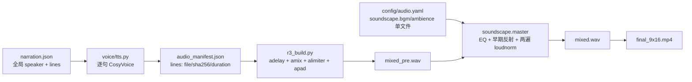
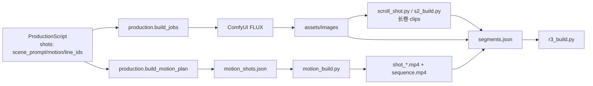

# 视听能力升级：仓库差距审计

> 文档状态：**审计 + 提案**（2026-11-04）。不是正式 PRD，不构成已批准需求。
> 唯一需求来源：[../PRD.md](../PRD.md)。本文件只记录代码现状、差距、兼容性与待确认项。
> 范围：多轨音频、BGM/SFX、角色音色、镜头运动/图层、叙事连续性、视听质量门。
> 原则：代码存在不等于能力通过；单测/Mock/历史产物不能冒充真实端到端。

---

## 0. 结论摘要

| 结论 | 证据 |
|---|---|
| **音频系统是当前最大缺口** | 现有 `r3_build` 只混旁白逐行 WAV；没有统一 `audio_tracks` 事件结构；BGM/环境音只是 `soundscape.py` 的单文件可选输入；没有 SFX 事件；没有实际 sidechain ducking |
| **多音色角色系统未实现** | `narration.json` 只有全局 `speaker`；`ScriptLine` 没有 `speaker_role/voice_profile_id`；没有 Voice Profile 配置或参考音管理 |
| **镜头运动已有较强基础** | `CameraMove` 已支持 static/push/pull/scroll/lateral/push+pan；`LocalMotionType` 已有水波/云/叶/芦苇/倒影/墨扩散；`RegionSpec`/`PlateSpec` 已有保护与分层；M7/P1/81.373 有真实产物 |
| **人物一致性不能承诺同脸** | `models.Character` 只有基础字段且仅测试使用；没有 Character Bible/Shot Bible；PRD 保留“不承诺跨镜头像素级同脸” |
| **视听质量门只覆盖一部分** | `quality.py` 有图片/视频/音频/成片/运动检查；没有 BGM/SFX/ducking/音画同步/授权素材的完整门 |
| **TTS 默认已切换并验证** | `config/audio.yaml tts.mode: zero_shot`；`PRD-TTS-001` = `PASS_VERIFIED`；默认 zero-shot 2 行 + 显式 SFT 1 行已真实验证；多音色档案为提案阶段 |

---

## 1. 当前音频数据流



### 1.1 已实现

- `voice/tts.py`：逐句合成、四层文本、pronunciation、header/ledger、manifest、48 kHz 重采样。
- `scripts/r3_build.py`：按 `audio_manifest.lines` 的 `duration_seconds`/`pause_after_ms` 计算时间轴，逐行 `adelay`，`amix`，`alimiter`，`apad`。
- `voice/timeline.py`：整数毫秒时间轴、SRT、字幕边界、尾部静音。
- `voice/soundscape.py`：可选母带处理（EQ、早期反射/卷积、两遍 EBU R128）；可选**单个** `ambience.track` 与**单个** `bgm.track`；`ducking` 配置已解析。
- `quality.check_audio_manifest`：逐行音频峰值/静音/时长/时间轴检查。

### 1.2 未实现 / 不完整

| 缺口 | 证据 |
|---|---|
| 统一 `audio_tracks` 结构 | `segments.json` 是镜头数组；`audio_manifest.json` 只有 `lines`；没有 track/event schema |
| 角色对白轨道 `dialogue` | TTS 没有 `speaker_role`/`voice_profile_id`；只有全局 `speaker` |
| 多 BGM/SFX 事件 | `soundscape.py` 只接受单个 `bgm.track`/`ambience.track`；没有 `start_ms/duration_ms/gain/fade` 事件 |
| Sidechain Ducking | `soundscape.py` 解析 `ducking`，但 `master()` 的 FFmpeg graph 从未使用 `sidechaincompress`；文档字符串声称实现，代码没有 |
| SFX | 没有 SFX 输入、事件、混音或质量检查 |
| 音频资产台账强制 | `assets/audio/manifest.json` 有 3 条手工记录，但 `grep` 显示没有代码读取/校验它；`soundscape` 直接接受路径 |
| 音频事件与画面对应 | timeline 只覆盖旁白行；BGM/SFX 没有“为什么在这个时间点”的记录 |
| 多轨混音 QA | 没有 BGM/SFX 峰值、ducking 深度、音画同步、授权完整性的检查 |

> **重要**：`soundscape.py` 的文档字符串第 4 点写“sidechain ducking”，但 `master()` 只做 `amix` + `loudnorm`。这是典型的“文档声称 > 代码实现”，不能写成 `PASS_VERIFIED`。

---

## 2. 当前视频/运动数据流



### 2.1 已实现（真实产物）

- 相机：`static` / `slow_push_in` / `slow_pull_out` / `scroll_pan` / `push_in_with_pan` / `slow_lateral_track`；`layered_parallax` 在类型中声明，但需要 plates，否则 `render.py` 拒绝。
- 局部运动：`water_ripple` / `leaf_sway` / `reed_sway` / `cloud_drift` / `petal_drift` / `bird_motion` / `reflection_distortion` / `ink_diffusion`。
- 区域：`RegionSpec` 的 7 种 role × 4 种 permission；`locked/hard_excluded` 自动从局部 alpha 扣除；`reflection` 必须 `follows` rigid object。
- 图层：`PlateSpec` / `PlateAnchor` / `motion/plates.py` / `_render_layered_shot`；M8 真实渲染 PASS_STATIC；仍是 opt-in。
- 质量：`check_rigid_protection`、`check_motion_quality`、`check_dynamic_aesthetics`、`check_color_continuity`。
- 真实案例：P1 motion 10.0 s；M7 水墨 10.087 s / 工笔 9.583 s；81.373 s 工笔用 `scroll_shot.py` + 预渲染 clips（不是 `motion.plan`）。

### 2.2 与提案需求的映射

| 提案模板 | 现有实现 | 结论 |
|---|---|---|
| `static` | `CameraMove.static` | 已存在 |
| `slow_push_in` | `CameraMove.slow_push_in` | 已存在 |
| `slow_pull_out` | `CameraMove.slow_pull_out` | 已存在 |
| `pan_left` / `pan_right` | `scroll_pan` + `direction=ltr/rtl` | 语义已有，名称不同 |
| `parallax` | `layered_parallax` + `PlateSpec` | 已有 opt-in，未成为默认 |
| `local_motion` | `LocalMotionSpec` + `local_policy` | 已存在 |
| 结构保护 | `RegionSpec locked/hard_excluded` + 刚体门 | 已有，依赖人工区域 |
| 六层 Shot 结构 | `PlateSpec` 多平面，不强制六层 | 可映射，不建议强拆 |

**结论**：MOTION-001/002/003 的大部分不是“从零实现”，而是**把已有能力产品化、命名统一、接入任务与质量门**。MOTION-004 的结构保护已有区域合同，但没有语义分割；必须继续依赖人工 authored regions。

---

## 3. 当前 TTS / 音色数据流

```text
ProductionScript.lines: line_id, text, source_segment_id
  -> narration.json: {speaker: 全局, speed, mode, lines: [text|{text,subtitle_text}]}
  -> voice/tts.py: 全局 speaker 或 zero-shot prompt
  -> audio_manifest.lines: speaker/chosen speaker, file, sha256, duration
```

### 3.1 已实现

- `tts_mode` 显式参数（CLI/任务/narration/config）；默认仍 `sft`（PRD 目标 `zero_shot`）。
- `/health` 校验实际模型：SFT = `CosyVoice` + 300M；zero-shot = `CosyVoice2` + 0.5B；错配拒绝。
- manifest 记录 `tts_mode/model_class/model_dir/speaker/speaker_id/runtime/prompt`。
- 真实：显式 SFT 1 行、显式 zero-shot 1 行；SFT 历史 P1/81.373。

### 3.2 未实现

- Voice Profile（`voice_profile_id`、参考音、参考文本、授权、状态）。
- 台词 `speaker_role`（narrator / character / poetry_reader）。
- 一篇作品内多音色混排。
- 角色级音色分配/回退/生成记录。
- 多角色对话轨道的混音策略（与旁白不同）。

### 3.3 VOICE-ASSET 现状

| 项 | 现状 |
|---|---|
| 来源发现 | 无 adapter；`assets/audio/manifest.json` 是手工清单 |
| 来源注册 | 无统一 source registry；本轮候选在 `experiments/voice_asset_discovery/registry.json` |
| 合规下载 | 无下载器；本轮仅手工拉取 1 条 LibriVox |
| 切片 | 无自动切片器；本轮手工切 5.25 s / 16 kHz mono |
| 文本对齐 | 无对齐器；Whisper base 只作辅助，1 条候选匹配 |
| 质量检测 | 无自动门；本轮手工 `volumedetect`/`silencedetect` |
| 授权审核 | 无工作流；`assets/audio/manifest.json` 无代码读取 |
| Prompt 注册表 | 无正式注册表；候选 JSON 未并入 manifest |
| Voice Profile | 无 schema/加载器 |
| 试听/评测 | 无 |
| 版本/哈希 | 单条 meta 有 hash；无版本链 |
| 定期更新 | 无 |

来源核验结论（2026-11-04）：

- **Common Voice**：CC0 数据集，但 MDC 账号 + Data Consumer Terms，禁止镜像/重新识别；当前 `BLOCKED`，未下载。
- **AISHELL-3**：OpenSLR 标 Apache-2.0，但第三方“仅学术”说法冲突；全量 19 GB 未下载。已下载官方 73 MiB Sample，选 2 条候选（3.83 s / 5.07 s）；CosyVoice2-0.5B zero-shot 实测均 PASS；来源仍 `BLOCKED`（许可待书面确认）。
- **LibriVox**：美国公有领域、允许商用、无需署名；其他辖区需复核；已拉取 1 条《鹿柴》候选，状态 `TECHNICALLY_VALIDATED` / `LICENSE_VERIFIED_US_ONLY`；本地 CosyVoice2-0.5B zero-shot 实测 PASS（技术可用），**仍不批准中国商用生产**。
- **Internet Archive 其他**：逐条权利；`DISCOVERED`。
- **Piper/Sherpa**：逐 Voice Model Card；测试源。
- **自录**：`LICENSE_VERIFIED`；人工试听前不 `APPROVED`。

详见 [VOICE_ASSET_SOURCE_REVIEW.md](VOICE_ASSET_SOURCE_REVIEW.md)。

> 编号冲突提醒：正式 PRD 已使用 `PRD-TTS-002` 表示“SFT 显式可选”。提案中的“多音色角色映射”不得复用 TTS-002；建议使用 `PRD-TTS-007`，详见提案文档。

---

## 4. 当前叙事/分镜结构

| 现有 | 位置 | 缺口 |
|---|---|---|
| `Character/Location/Prop` 严格模型 | `models.py` | 仅测试使用；无 Character Bible；不进入生产 |
| `ProductionScript.ScriptShot` | `script_engine.py` | 有 `scene_prompt/visual_prompt/motion/line_ids`；没有人物/地点/道具引用、时间/季节、前后镜头关系 |
| `ContentPackage.ScenePlanItem` | `literary_intelligence/schemas/content_package.py` | 有 `scene_id/duration/visual_source/camera_motion/visual_prompt/subtitle_ids`；没有角色/地点/连续性 |
| `segments.json` | 生产输入 | 镜头源/时长/line_ids/prompt；没有 `shot_bible`/`character_ids` |
| `discovery` | 工作台 | 只读 segments；没有 Shot Bible/连续性视图 |

**结论**：人物视觉锚点/分镜连续性目前是 `NOT_IMPLEMENTED` 到 `PARTIAL`；不能把 `models.Character` 的存在当成生产能力。PRD 必须保留“L3 跨镜头同脸非目标”。

---

## 5. 当前质量门

| 检查 | 实现 | 覆盖 |
|---|---|---|
| 图片空/黑 | `quality.check_image` | 有 |
| 视频解码/尺寸 | `quality.check_video` | 有；无黑帧/帧率异常检测 |
| 逐行音频 | `quality.check_audio_manifest` | 有；只覆盖旁白行 |
| 成片 | `quality.check_build` | 1080×1920、哈希、解码、混音 |
| 运动 | `check_rigid_protection`/`check_motion_quality` | 有；依赖 authored regions |
| 动态美学 | `check_dynamic_aesthetics`/`check_color_continuity` | 有；只是风险提示 |
| BGM/SFX/ducking | 无 | **缺** |
| 音画同步 | timeline 检查 | 只覆盖旁白/字幕；无 BGM/SFX 事件 |
| 授权素材 | 无代码门 | **缺** |
| 人工视听 | `review.accept/reject` + `human_review.json` | 有写入；无结构化清单 |

---

## 6. Schema 兼容性

| 文件 | 当前形状 | 提案风险 | 建议 |
|---|---|---|---|
| `segments.json` | JSON 数组（`r3_build`/`discovery`/`build_segments` 期望数组） | 直接加 `audio_tracks` 会破坏所有消费者 | **不要改数组形状**；新增 sidecar `audio_timeline.json` |
| `audio_manifest.json` | `{speaker, speed, mode, header, ledger, lines[]}` | 直接把 BGM/SFX 塞进 `lines` 会混淆语义 | 保留 `lines` 为旁白/对白 TTS；新增 `tracks` 或 sidecar |
| `build_manifest.json` | 已有 `soundscape`/`timeline`/`outputs` | 新字段可加；旧读者需忽略未知 | 新增 `audio_timeline` 路径/哈希、`audio_qa` |
| `ProductionScript` | `extra="forbid"` | 新字段必须同步更新模型；LLM 合同可能不需要改 | 角色映射优先用 sidecar `voice_cast.json`，避免污染 LLM 合同 |
| `narration.json` | `lines` 可为字符串/对象 | 新增 `speaker_role`/`voice_profile_id` 可能被旧 `line_layers` 忽略 | 先加可选字段并测试；或使用 sidecar cast |
| `config/audio.yaml` | `soundscape.bgm.track` 单文件 | 不能表达多事件 | 新 `audio_timeline` 引用 asset_id；保留旧字段兼容 |
| `assets/audio/manifest.json` | 手工 `assets[]` | 没有代码读取；字段与提案不完全一致 | 扩展 schema 并增加 `voice/assets.py` 校验 |
| `config/styles.yaml` | camera/local policy | 新模板名称可能重复 | 复用现有 `CameraMove`；只加文档别名，不另起枚举 |

---

## 7. 需要修改的文件（提案级）

### 7.1 音频

```text
src/drama_studio/voice/audio_timeline.py      # 新：schema + 事件校验 + 从 audio_manifest 派生旁白事件
src/drama_studio/voice/audio_assets.py        # 新：assets/audio/manifest.json 读取/校验/哈希
src/drama_studio/voice/mix.py                 # 新：FFmpeg 多轨混音（或扩展 soundscape.py）
src/drama_studio/voice/soundscape.py          # 扩展：ducking/BGM/SFX；或只做母带
scripts/r3_build.py                           # 接受 --audio-timeline；保留旧路径
src/drama_studio/quality.py                   # 新增 audio timeline/mix/license 检查
src/drama_studio/workspace/tasks.py           # audio.plan / audio.mix / audio.qa?（需批准）
config/audio.yaml                             # BGM/SFX 默认值/阈值
assets/audio/manifest.json                    # 扩展 asset registry
```

### 7.2 TTS / Voice Profile

```text
src/drama_studio/voice/tts.py                 # voice_profile_id、speaker_role、manifest 扩展
src/drama_studio/voice/voice_profiles.py      # 新：Voice Profile schema/加载/授权
config/voices.yaml                            # 新：音色配置（或 assets/voices/*.json）
src/drama_studio/script_engine.py             # 可选 speaker_role/voice_profile_id（sidecar 优先）
scripts/r3_tts.py                             # --voice-profile/--speaker-role
assets/audio/manifest.json                    # 参考音授权登记
```

### 7.3 运动 / 叙事 / QA

```text
src/drama_studio/motion/spec.py               # 仅文档/别名；不新增引擎
src/drama_studio/production.py                # shot_bible/character_ids 可选字段（若批准）
src/drama_studio/models.py                    # Character Bible/Shot Bible（或新模块）
src/drama_studio/quality.py                   # 音频/视频/连续性/授权检查
src/drama_studio/workspace/tasks.py           # 新任务注册（需批准）
docs/PRD.md                                   # 仅在批准后写入正式需求
docs/REQUIREMENT_TRACEABILITY.md              # 仅在批准后加正式行
```

---

## 8. 当前测试与证据基线

- 测试：`pytest` **354 passed**（2026-11-04 工作区，后续批次）。
- 真实 TTS 证据（工作区，未提交）：`experiments/tts_mode_check/sft/audio_manifest.json`、`.../zero_shot/audio_manifest.json`。
- 真实音频/成片：P1 14.0 s、R3 38.042 s、81.373 s 工笔、M7 两片。
- 音频单测：`tests/test_soundscape.py` 13 项，覆盖 EQ/反射/响度/IR；**没有 ducking/BGM/SFX 测试**。
- 运动单测：`test_motion*`、`test_motion_regions`、`test_motion_plates*`、`test_motion_quality_gates`。
- 质量单测：`test_quality`、`test_quality_plates`。

---

## 9. 关键风险

| 编号 | 风险 | 影响 |
|---|---|---|
| R-A1 | 把 `ducking` 配置存在当成已实现 | 验收会假通过；实际 BGM 不闪避 |
| R-A2 | 直接改 `segments.json` 形状 | 破坏 `r3_build`/`discovery`/`build_segments` |
| R-A3 | BGM/SFX 素材无授权 | 不可发布 |
| R-A4 | 多音色只加 `speaker_role` 字符串 | 无法追溯实际音色/参考音/模型 |
| R-A5 | 把 Motion 现有能力当“新功能”重复造引擎 | 增加维护负担，破坏已验证路径 |
| R-A6 | 人物视觉锚点被写成“同脸保证” | 超出模型/硬件能力，违反 PRD 非目标 |
| R-A7 | 全片 Wan 化 | A750 8 GB / 单飞 GPU 成本不可接受 |
| R-A8 | 不兼容旧 manifest | 历史构建无法复现/对比 |

---

## 10. 待确认（OPEN_QUESTION）

1. 多轨音频用 **sidecar `audio_timeline.json`** 还是扩展现有 `audio_manifest.json`？（建议 sidecar，保留旧数组/旧 lines 兼容）
2. Voice Profile 放 `config/voices.yaml` 还是 `assets/voices/*.json`？是否进入 `workspace.db`？
3. BGM/SFX 首批素材来源与授权；是否允许无 BGM 的降级版本？
4. Ducking 触发是仅旁白，还是旁白+对白？阈值/比例/attack/release 需真实听感调试。
5. 多音色角色映射的实现批次：P1 音频阶段还是 P3？本提案建议先 schema，后实现。
6. 60–90 s 样片用哪篇已有内容？是否使用 81.373 s 工笔的素材/风格？
7. 新需求编号 `PRD-TTS-007` 是否批准（避免与现有 `PRD-TTS-002` 冲突）。
